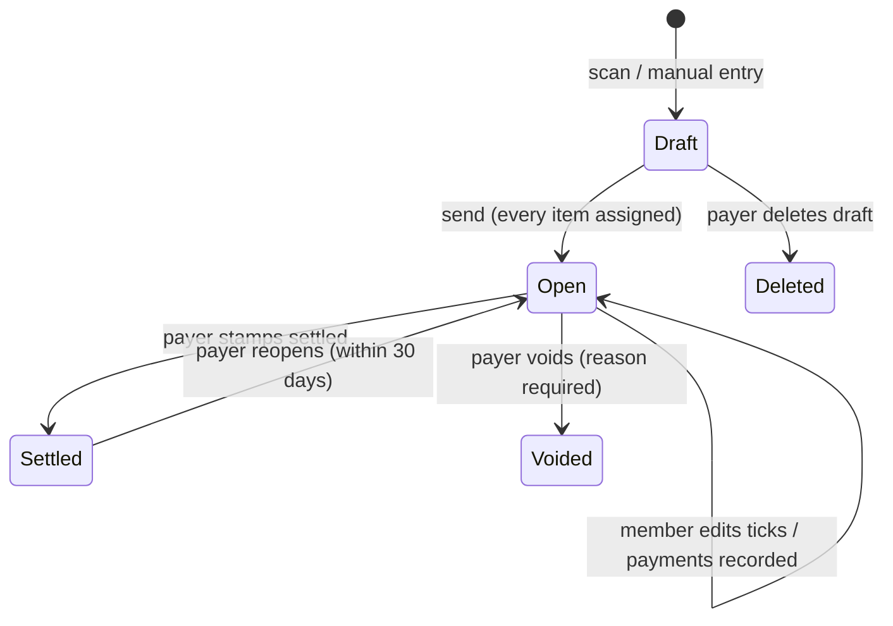
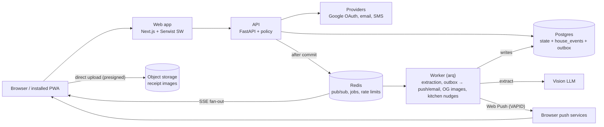
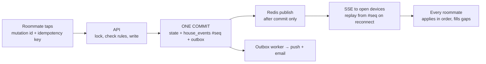

# KitchenTab — PRD & Technical Spec

Oct 9, 2026 · Pranav · mockups: `docs/design/` · money reference: `docs/reference/compute_shares_reference.py` + `packages/fixtures/money_cases.json` · tests: `docs/TEST_PLAN.md`

> **Changes since the handoff (BUILD_ALL.md §1, 2026-10-09).** Receipt extraction runs locally with no API key (text PDFs on the server, OCR in the browser; ADR-0010). The app deploys as one Vercel project on the Hobby plan with Neon Postgres, Vercel Blob and Vercel Queues, and no Redis in production (ADR-0011 to ADR-0015). Day-one sign-in is email codes through Gmail SMTP, with a secret-guarded test inbox until then; phone and Google buttons stay hidden until their keys exist (ADR-0016). Sections 3, 5.2, 9, 11, 12, 13 and 18 are updated to match.

## 1. Overview

KitchenTab is a browser-first web app that turns one grocery receipt into fair per-person shares for a household, with no app download required. Build it as a mobile-first Progressive Web App (PWA) and treat this document as the build contract for Claude Code.

**Problem.** Roommates who place one shared grocery order split it badly today. Either they split everything evenly (unfair: one person's protein bars get split four ways) or someone itemizes in a spreadsheet (slow, so it stops happening). Generic tools like Splitwise split totals, not line items, and require everyone to install an app.

**Product in one line.** Snap a receipt, the app lists each item with its price, tick which roommates use each item, send one link; the bill stays open and editable until the payer marks it settled. Every food item then lands in a shared, illustrated Fridge or Pantry showing who owns it, what's open to share, and a way to ask for the rest (section 19).

**Goals (MVP)**

1. A payer goes from receipt photo to a sent bill in under 3 minutes for a 15-item receipt.
2. A roommate goes from tapping a shared link to seeing their share in under 10 seconds, with no account.
3. A roommate claims their identity and edits their items in under 60 seconds on first visit.
4. Every share is exact to the cent: the sum of all shares always equals the receipt total.
5. Works fully in mobile Safari and Chrome, installs to the home screen like an app on iPhone, Android and desktop, and sends push notifications (section 20); installing is never required.

**Success metrics (first 90 days after launch)**

| Metric | Definition | Target |
| --- | --- | --- |
| Activation | Houses that send at least 1 bill within 7 days of creation | 60% |
| Roommate join rate | Placeholder members who claim their name within 7 days of first bill | 70% |
| Repeat use | Active houses that send 2+ bills in 30 days | 50% |
| OCR accuracy | Line items accepted without manual edit | 90% |
| Time to send | Median seconds from upload to send | under 180 s |

**Non-goals (MVP)**

- Moving money. The app records payments and deep-links to Venmo, Zelle, Cash App or PayPal; it never holds or transfers funds.
- Native iOS or Android apps.
- General expense splitting (rent, utilities, trips). Groceries only for v1; the data model must not block it later.
- Multi-currency. USD only for v1; store currency on every money record anyway.
- Budgets, analytics dashboards or spending insights.

## 2. Users and use cases

Two roles matter: the **payer** who uploads and sends a bill, and **members** who review and pay. Any member can be the payer on a different bill.

| Persona | Who | Device and context | What they need |
| --- | --- | --- | --- |
| Payer (house organizer) | Places the shared order, usually the same 1–2 people | Phone, right after unpacking groceries | Fast receipt entry, clear split, one-tap share, know who has paid |
| Member | Roommate who consumed items | Phone, opens link from group chat | See own share instantly, fix wrong ticks, pay without friction |
| New member | Moved in mid-lease, or was added as a placeholder | Phone browser, never used the app | Join from a link, claim name, no install |
| Guest | Partner or friend who shared one order | Phone browser | Be added to one bill without joining the house |

**Use cases**

| ID | Actor | Use case | Result |
| --- | --- | --- | --- |
| UC-01 | Payer | Create a house and sign in with Google, email code or phone code | House exists, payer is admin |
| UC-02 | Payer | Add roommates by first name (placeholders) | Members exist before they sign in |
| UC-03 | Payer | Share the house invite link | Roommates can join |
| UC-04 | Member | Open invite or bill link, view without sign-in, claim a placeholder, verify | Member is linked to a verified account |
| UC-05 | Payer | Upload a receipt photo or PDF | Store, date, items, prices, tax and total extracted |
| UC-06 | Payer | Review and correct extracted items, add missed items | Items match the receipt total |
| UC-07 | Payer | Tick which members use each item, or split the rest with everyone | Every item has 1+ members, shares computed live |
| UC-08 | Payer | Review per-person totals and send | Bill state becomes Open, members notified |
| UC-09 | Member | Add or remove themselves from items on an open bill | Shares recalculated, change logged, affected people notified |
| UC-10 | Member | Pay via a deep link and mark as paid | Payment recorded, pending payer confirmation |
| UC-11 | Payer | Confirm or reject a recorded payment | Payment confirmed, balance updated |
| UC-12 | Payer | Nudge unpaid members | Reminder sent, rate-limited |
| UC-13 | Payer | Mark bill settled | Bill locked, moves to history |
| UC-14 | Payer | Reopen a settled bill (within 30 days) | Bill editable again, reopen logged |
| UC-15 | Any member | View balances across all open bills in the house | Net who-owes-whom |
| UC-16 | Admin | Rename house, remove a member, transfer admin | House settings updated |
| UC-17 | Member | Leave a house | Removed from future bills, open balances kept |
| UC-18 | Any user | Switch light/dark mode | Preference saved per device and per account |
| UC-19 | Any user | Delete their account and data | Personal data erased, names on old bills anonymized |

## 3. Scope

MVP ships the full loop for one house: sign in, add roommates, scan, split, send, edit, record payments, settle. Everything else waits.

| Capability | MVP (v1) | v1.1 | Later |
| --- | --- | --- | --- |
| Sign-in | Email code on day one (Gmail SMTP); Google OAuth and phone OTP built and shown once their keys are set (ADR-0016) | Apple sign-in | Passkeys |
| Houses | One or more houses per user, switcher in header | House avatar and color | — |
| Receipt input | Photo (camera or gallery), PDF upload (first-class, multi-page, drag-and-drop on desktop), manual entry | Forward order-confirmation email to a house address | Instacart, Amazon Fresh, Walmart order import |
| Extraction | Local extraction with no API key: server text-PDF parsing and in-browser OCR feeding one receipt parser with confidence flags; LLM plugin optional (ADR-0010) | Learn item names per house ("usual suspects") | Auto-suggest who uses what from history |
| Splitting | Equal split among ticked members per item | Weighted shares (2×, custom %) and quantity splits (3 of 6 cans) | Split by unit price per person |
| Tax and fees | Proportional to subtotal share | Per-item taxable flag; tip, delivery and service fee handling options | — |
| Discounts | Line-level discounts and coupons attached to item | Order-level discount allocation options | — |
| Sharing | Group link, personal nudge links, Web Share API, copy link, installable app, web push (section 20) | Email digest of changes | Native app wrappers |
| Payments | Record payment + deep links; payer confirms | Settle-up across multiple bills in one payment | — |
| Balances | Per-bill and house-wide net balances | Simplified debts (minimize transfers) | — |
| Guests | Add a guest to a single bill by name + link | — | — |
| Theming | Light and dark, system default | — | — |
| Export | CSV export of a bill | House history CSV | — |
| Admin | Rename house, remove member, transfer admin | Archive house | — |

Anything not in the MVP column is out of scope for the first build, but the data model in section 10 must not need a migration to add the v1.1 split types (weights and quantities are stored from day one). The Fridge and pantry (section 19) is MVP; "running low" with a next-shopping-list, and per-unit quantity tracking, come later.

## 4. User flows

Five journeys cover the MVP; each maps to screens on the design canvas (letters = onboarding row, numbers = core row). Every bill moves through the lifecycle below.



Only an open bill accepts tick changes and payments; settling locks it, and only the payer can reopen it within 30 days.

### 4.1 Payer: first-time setup (A → B → C)

1. Open the site, tap "Start a house", choose Google, email code or phone code.
2. Enter the 6-digit code (or return from Google) and land on "Who lives here?".
3. Name the house and add roommates by first name; they become placeholders.
4. Share the invite link to the group chat (skippable).
5. Tap "Snap your first receipt" to go straight into 4.2.

### 4.2 Payer: new bill (2 → 3 → 4 → E)

1. Take or pick a photo (or PDF, or Manual entry); skeleton receipt lines show while extraction runs.
2. "Did we read it right?": fix flagged lines, confirm store, date and paid by; totals must reconcile.
3. "Who's eating what?": tick members per item, use "Split the rest with everyone"; totals update live; Send unlocks at 100% assigned.
4. "Here's the damage": per-person totals and item lists; tap Send.
5. Share card: share to the group chat, send personal nudges, keep the email toggle; Done opens the bill.

### 4.3 Roommate: first open from a link (D → 5)

1. Tap the link in the group chat; the bill opens read-only, with no sign-in.
2. "Which one are you?": pick their name, then verify with Google, email code or phone code.
3. Land on the bill filtered to "Your items"; tick or untick; others see it within 2 s.
4. Tap Pay, pick a method, finish payment in Venmo or similar, return and tap "Mark as paid".

### 4.4 Returning member

1. The session is remembered for 30 days; Home shows net balance and open tabs.
2. Bills whose share changed show a badge and the delta until viewed.

### 4.5 Payer: close-out (5)

1. Confirm or reject recorded payments; nudge anyone unpaid.
2. Tap "Stamp it settled"; if money is still owed, a dialog shows who owes what and that it will carry into house balances.
3. The SETTLED stamp lands and the bill moves to history.

## 5. Functional requirements

Each requirement is testable; "Must" ships in MVP, "Should" ships in MVP if time allows. Acceptance criteria are the test cases.

### 5.1 Accounts and houses

| ID | Priority | Requirement | Acceptance criteria |
| --- | --- | --- | --- |
| FR-01 | Must | Sign in with Google OAuth, email one-time code, or SMS one-time code | Each method creates or finds one user; same verified email across methods resolves to the same user |
| FR-02 | Must | Create a house with a name (1–40 chars) | Creator becomes member with role `admin` |
| FR-03 | Must | Add placeholder members by display name (1–24 chars, unique within house, case-insensitive) | Placeholder can be ticked on items immediately |
| FR-04 | Must | Generate one house invite link per house; admin can rotate it | Old link returns 410 after rotation |
| FR-05 | Must | Join via invite link: pick an unclaimed placeholder or "I'm new" (creates a member), then verify | Claimed member's `user_id` set; placeholder disappears from picker for others |
| FR-06 | Must | Admin can remove a member; member can leave | Removed member is excluded from new bills; existing bill allocations and balances remain |
| FR-07 | Must | Admin can transfer admin to another claimed member | Exactly one admin per house at all times |
| FR-08 | Should | User can belong to multiple houses with a switcher | Last-used house opens by default |
| FR-09 | Must | Admin can undo a wrong claim (unlink user from member) | Member returns to placeholder; audit entry written |

### 5.2 Receipt capture and review

| ID | Priority | Requirement | Acceptance criteria |
| --- | --- | --- | --- |
| FR-10 | Must | Upload JPEG, PNG, HEIC, WEBP or PDF up to 20 MB (PDF up to 10 pages), via camera, photo library, "Upload PDF" or drag-and-drop; files go straight from the browser to storage | HEIC converted on device; text PDFs parsed on the server; photos and scanned PDFs OCR'd in the browser (ADR-0010, ADR-0015) |
| FR-11 | Must | Extract store name, purchase date, line items (name, quantity, unit price, line total), discounts, subtotal, tax, fees, total | Text PDF result in under 5 s at p90; in-browser OCR under 15 s at p90 on a mid-range phone |
| FR-12 | Must | Flag low-confidence fields (confidence < 0.8) for review | Flagged rows show a "Check?" chip |
| FR-13 | Must | Show reconciliation: sum of items + tax + fees − discounts vs receipt total | Mismatch shows the difference and blocks Next until resolved or overridden with a reason. An override stores the printed total in `bills.printed_total_cents` (which becomes `total_cents`) and adds one signed `bill_fees` row of kind `adjustment` for the difference, allocated like tax (section 6); the reason is logged |
| FR-14 | Must | Edit any field, add, delete, merge or split items | Changes saved as draft every 2 s |
| FR-15 | Must | Manual entry without a photo | Same review screen, empty list |
| FR-16 | Must | Set "Paid by" (default: uploader) and purchase date (default: extracted, else today) | Payer must be a house member |
| FR-17 | Should | Duplicate detection: same store + date + total ±$0.01 in the same house within 14 days | Warning with a link to the existing bill |
| FR-18 | Must | Store the original image privately | Viewable by house members only, via signed URL |

### 5.3 Splitting

| ID | Priority | Requirement | Acceptance criteria |
| --- | --- | --- | --- |
| FR-20 | Must | Per item, one checkbox per active house member | Toggle is optimistic and persists within 500 ms |
| FR-21 | Must | "Split the rest with everyone" assigns all unassigned items to all active members | Only unassigned items change |
| FR-22 | Must | Tap a member's column header to tick or untick them on every item | Confirmation toast with Undo |
| FR-23 | Must | Live per-person totals including allocated tax and fees | Totals match section 6 algorithm exactly |
| FR-24 | Must | Progress indicator "N of M assigned"; Send disabled until every item has 1+ member | Disabled state explains why |
| FR-25 | Must | Add a guest (name only) to this bill | Guest gets a personal link; guest is not a house member |
| FR-26 | Should | Exclude a member from a bill entirely (away that week) | Their column hidden for this bill |
| FR-27 | Must | Undo the last 10 split actions in the session | Undo restores state and recomputes |

### 5.4 Sending, editing and settling

| ID | Priority | Requirement | Acceptance criteria |
| --- | --- | --- | --- |
| FR-30 | Must | Review screen lists each person's total and items | Totals sum to the receipt total |
| FR-31 | Must | Send moves bill from `draft` to `open` and creates a bill link | Share card opens with Web Share API, copy fallback |
| FR-32 | Must | Any verified member on the bill can tick or untick themselves on any item while open | Change logged with actor, before and after shares |
| FR-33 | Must | The payer can change anyone's ticks while open | Logged as "Pranav moved Kabir off Bananas" |
| FR-34 | Must | A member cannot leave an item with zero people | Last person's untick is blocked with a message |
| FR-35 | Must | When a share changes, affected members see a "changed" badge and delta on next view | Badge clears after viewing |
| FR-36 | Must | Member records a payment (amount defaults to outstanding, method, optional note) | Status `pending_confirmation` |
| FR-37 | Must | Payer confirms or rejects a payment | Confirmed payments update balance; rejected ones notify the member |
| FR-38 | Must | Payer can record a payment on someone's behalf (cash) | Status `confirmed` immediately |
| FR-39 | Must | Payer marks bill settled; allowed with outstanding balance only after a confirm dialog | Bill `settled`, all edits blocked, outstanding carried to house balances |
| FR-40 | Must | Payer can reopen a settled bill within 30 days | State back to `open`, logged |
| FR-41 | Should | Auto-reminder to unpaid members 3 and 7 days after send, if opted in | Max 1 reminder per member per bill per 48 h |
| FR-42 | Must | Payer can delete a draft; open bills can be voided (not deleted) with a reason | Voided bills keep the audit log and drop out of balances |
| FR-43 | Must | Activity log per bill, newest first | Shows scans, sends, edits, payments, settle, reopen |

### 5.5 Balances and history

| ID | Priority | Requirement | Acceptance criteria |
| --- | --- | --- | --- |
| FR-50 | Must | Home shows the signed-in user's net position: owed, owing, credits | Matches sum across open bills plus carried balances |
| FR-51 | Must | Per-pair balances ("Arjun owes you $33.91") | Pairwise: each pair is netted across all open bills and ledger entries (Meera owes you $22.24 on ShopRite, you owe her $14.10 on H Mart → "MEERA → YOU $8.14"); no simplification across three or more people in MVP |
| FR-52 | Must | Lists of open bills (newest first) and settled bills (paginated, 20 per page) | Each card shows store, date, payer, total, payment progress |
| FR-53 | Should | Search bills by store or item name | Results in under 500 ms |
| FR-54 | Should | Export a bill as CSV | One row per item × member allocation |

## 6. Split math and money rules

All money is stored and computed as integer cents; floats never touch money. One pure function, `compute_shares(bill)`, is the single source of truth, runs on the server, and is mirrored in TypeScript for instant UI updates; both are tested against the same fixture file.

**Inputs per item:** `line_total_cents` (after line-level discounts), and a set of allocations `{member_id, weight}` where weight defaults to 1. An allocation may instead hold a fixed share of its line, `share = share_num / share_den` with 0 < share ≤ 1 (the custom split on an ask, FR-81, ADR-0030).

**Fixed shares (step 1 detail).** On a line with fixed shares f₁…fₖ and weighted allocations, each fixed allocation's exact part is fᵢ and the weighted allocations split 1 − Σf in proportion to weight. If Σf ≥ 1, or nobody on the line is weighted, the fixed shares split the whole line in proportion to f and the weighted allocations get 0 (they stay on the line). The exact parts then go through the same largest-remainder rounding, so the invariant is unchanged. A percent p is stored as p/100; an owner's own value of X cents on a line of L cents is stored as X/L, so the asker's line share is exactly X.

**Algorithm**

1. For each item, split `line_total_cents` across its allocated members in proportion to weight using the largest-remainder method: give each member `floor(total × w / W)`, then hand out the leftover cents one at a time to members with the largest fractional remainders; break ties by member `sort_order`, then `id`.
2. Sum each member's item cents into `item_subtotal[m]`.
3. Allocate each bill-level amount (tax, each fee or tip, each order-level discount as a negative amount, and the reconciliation adjustment if any) proportionally to `item_subtotal[m]`, again with largest-remainder. Each amount is rounded on its own, in that order; they are never summed first.
4. `share[m] = item_subtotal[m] + allocated_tax[m] + allocated_fees[m] − allocated_discounts[m] + allocated_adjustment[m]`.
5. Invariant check: `Σ share[m] == bill.total_cents`. If it fails, refuse to save and log an error; never silently adjust.

**Reconciliation override (FR-13).** When the payer chooses "Use receipt total anyway", the printed total is stored as `bills.printed_total_cents` and becomes `total_cents`, and one `bill_fees` row of kind `adjustment` holds the signed difference (printed total − items − tax − fees + discounts). It is allocated in step 3 like tax, so the invariant in step 5 still holds. Fixtures `reconciliation_adjustment` and `reconciliation_adjustment_negative` cover it.

Largest-remainder replaces the mockup's "leftover cent goes to the payer" rule: it is fairer and deterministic. The UI shows no rounding note unless a member asks via the info icon.

```latex
\text{share}_m = \sum_{i \in \text{items}(m)} \text{LR}\!\left(c_i \cdot \frac{w_{i,m}}{\sum_k w_{i,k}}\right) + \sum_{a \in \text{billLevel}} \text{LR}\!\left(a \cdot \frac{\text{sub}^{+}_m}{\sum_k \text{sub}^{+}_k}\right)
```

LR = largest-remainder rounding to whole cents; c = item line total, w = weight, billLevel = tax, each fee or tip, each order discount (negative) and the adjustment (signed), each rounded separately; sub⁺ = item subtotal clipped at 0. `docs/reference/compute_shares_reference.py` is the executable definition and wins over this formula.

**Payment and balance rules**

- `owed[m] = share[m] − confirmed_payments[m]` for every non-payer member; the payer's own share is never owed to anyone.
- If `owed[m] < 0` after an edit (paid more than the new share), the bill shows a credit: "Payer owes Kabir $1.68". The credit stays on the bill until the payer records a refund or the bill is settled, at which point it carries into house balances. A refund is a `payments` row in the other direction (`direction = refund`: from the payer to the member), not a status.
- Pending (unconfirmed) payments show as "paid, awaiting confirmation" but do not reduce `owed`.
- Settling with nonzero `owed` moves each remaining amount into the pairwise house ledger as a `carryover` entry, so nothing is lost.
- House balance between A and B = Σ open-bill owed amounts between them + Σ carryover entries − Σ cross-bill settle-up payments (v1.1).
- Voided bills contribute nothing; their confirmed payments become credits to the payer's counterparty, recorded as `ledger_entries` with source `void_credit` (from the payer to the member who paid).

**Edge rules**

- A bill with exactly one member on every item is valid ("just you").
- An item can be allocated to a guest; guests follow the same owed/payment rules but have no house balance.
- Zero-priced items (free with promo) are allowed and allocated, contributing 0. Bill-level amounts are allocated by each person's item subtotal clipped at 0; if every subtotal is 0 or less, they are split equally among everyone with at least one allocation. Negative amounts (discounts, deposit returns) are rounded on their absolute value, then negated.
- Negative line items (bottle deposit returns) are allowed and allocated like any item.
- Maximum 200 items per bill, 20 members per house, $100,000.00 per bill.

## 7. Auth and identity

Viewing a bill needs only its link; any write needs a verified user who has claimed a member. Three sign-in methods map to one `users` row through `auth_identities`.

**Methods**

| Method | Flow | Provider (suggested) | Limits |
| --- | --- | --- | --- |
| Google | OAuth 2.0 / OIDC authorization code with PKCE; scopes `openid email profile` | Google Identity Services, official button per brand guidelines | Requires `email_verified = true` |
| Email code | 6-digit numeric code, valid 10 min, single use | Transactional email (Resend, Postmark or SES) | 5 sends per email per hour; 5 wrong attempts locks the code |
| Phone code | 6-digit code by SMS, valid 10 min, single use; E.164 numbers, US only in v1 | Twilio Verify or similar | 3 sends per number per hour, 10 per IP per day; CAPTCHA (Turnstile) after 2 sends |

**Account linking**

- A verified email from Google and a verified email from an email code are the same identity: they resolve to the same user.
- A phone identity is a separate login method. A signed-in user can attach a phone or email in Settings; it must be verified before it links.
- Never auto-merge two existing users. If a user signs in with a method already tied to a different user, show "This is linked to another account" and offer sign-in with that one.

**Sessions**

- Server-issued session in an `HttpOnly`, `Secure`, `SameSite=Lax` cookie; opaque token, hashed in the `sessions` table.
- 30-day sliding expiry, refreshed on use; "Sign out everywhere" revokes all sessions.
- CSRF protection on every state-changing request (double-submit token or `SameSite` plus Origin check).

**Placeholders and claiming**

1. Admin adds "Meera" → `members` row with `user_id = null`, `status = placeholder`.
2. A visitor opens an invite or bill link → sees the bill read-only (FR-31) and a "Which one are you?" picker of unclaimed placeholders plus "I'm new".
3. They pick "Meera" → sign in with any method → server sets `members.user_id` in a transaction that fails if it is already set (no double claim).
4. The device remembers the claim; next visits go straight to their view.
5. Admin can reverse a wrong claim (FR-09). A user can be a member of many houses but only one member per house.

**Authorization**

| Action | Who |
| --- | --- |
| View bill via link | Anyone holding a valid, non-revoked link |
| View receipt image | Signed-in members of the house |
| Edit own ticks on an open bill | The claimed member, or a guest via their personal link + verification |
| Edit anyone's ticks, items, prices, tax | The bill's payer |
| Record payment for self | Member on the bill |
| Confirm payments, settle, reopen, void | The bill's payer |
| Manage members, rotate invite link | House admin |

Enforce every rule in the API layer with a single policy module; the UI only hides buttons.

## 8. Sharing, links and notifications

The group-chat link is the primary channel; push notifications (section 20) and email carry updates after that. No feature may depend on a notification arriving.

**Link types**

| Link | Path | Token | Grants | Lifetime |
| --- | --- | --- | --- | --- |
| House invite | `/h/{token}` | 128-bit random, base62 (22 chars), stored hashed | Join picker for that house | Until rotated |
| Bill | `/b/{token}` | Same | Read-only view of that bill; join picker if not signed in | Until bill is voided or 90 days after settle |
| Personal nudge | `/b/{token}?m={member_token}` | Separate per-member token | Opens the bill pre-filtered to that member's share; still needs sign-in to edit | Same as bill |
| Guest | `/g/{token}` | Per guest per bill | View that bill, claim guest, verify to edit own ticks | Same as bill |

Tokens are never sequential, never contain IDs, and are compared in constant time. All link pages send `Referrer-Policy: no-referrer` and `X-Robots-Tag: noindex`.

**Link previews (Open Graph)**

- Bill links render a server-side OG card: store, date, total, "split N ways", house name. Never member names or amounts per person in the preview.
- Generate a 1200×630 PNG per bill (receipt-style design, section 14) and cache it; regenerate when the total changes.
- iMessage, WhatsApp, Slack and Discord must show the card; test with each.

**Share actions**

1. "Share" calls `navigator.share({title, text, url})`; if unavailable, copies the link and shows "Copied".
2. Default text: "Groceries are in. Tick anything I got wrong." editable before sharing.
3. Personal nudges use the same API with text like "Your share of ShopRite 10/02 is $33.91".

**Notifications**

| Event | Who | Email (opt-out per user) | In-app badge | SMS |
| --- | --- | --- | --- | --- |
| Bill sent | All members on bill | Yes, with share amount | Yes | No (cost) |
| My share changed by ≥ $0.50 | That member | Batched digest, max 1 per bill per 6 h | Yes, with delta | No |
| Payment recorded | Payer | Yes | Yes | No |
| Payment confirmed or rejected | Member | Yes | Yes | No |
| Reminder or nudge | Unpaid member | Yes | Yes | No |
| Bill settled or reopened | All on bill | Yes | Yes | No |

- Email only goes to members with a verified email. Every email carries one-click unsubscribe (List-Unsubscribe header) and a footer link to notification settings.
- SMS is used only for sign-in codes in v1.
- Web Push is MVP: section 20.2 has the full channel matrix, permission flow, payloads and delivery rules, and it overrides this table where they differ. Batching is per channel: share-changed email keeps the 6 h digest above, while share-changed push coalesces over 10 minutes (section 20.2).

**Payment deep links**

| Method | Link pattern | Prefill |
| --- | --- | --- |
| Venmo | `venmo://paycharge?txn=pay&recipients={handle}&amount={x}&note={n}`, web fallback | Recipient, amount, note |
| Cash App | `https://cash.app/${cashtag}/{amount}` | Recipient, amount |
| PayPal | `https://paypal.me/{handle}/{amount}` | Recipient, amount |
| Zelle | No public deep link: show payer's Zelle email or phone with a copy button | Copy only |

Payers add handles in Settings; the Pay button lists only methods the payer has set. Verify each link format during build; do not assume these patterns are current.

## 9. Receipt ingestion and extraction

Extraction runs with **no API key** (ADR-0010). Text PDFs are parsed on the server; photos and scanned PDFs are OCR'd in the browser with `tesseract.js`; both feed one receipt parser (`apps/api/app/extraction/parser.py`) that returns the `ExtractedBill` schema below with per-line confidence. A vision-LLM extractor remains an optional plugin behind the same `ReceiptExtractor` interface, enabled only when `EXTRACTOR_API_KEY` is set.

**Pipeline**

1. **Upload:** the client asks `POST /api/v1/uploads/authorize` for an upload ticket (policy check), uploads the file directly to storage (Vercel Blob client upload in production, MinIO or the fake blob service locally; ADR-0015), then calls `POST /bills/{id}/receipts` with the stored key. 20 MB and 10 PDF pages max; nothing passes through a function body.
2. **Text or OCR:** for a PDF with a text layer the server extracts lines with positions (`pdfplumber`, fallback `pypdf`). For photos and scanned PDFs the browser renders pages (`pdfjs-dist`), preprocesses (EXIF rotate, grayscale, contrast, adaptive threshold, deskew, max 2000 px) and runs `tesseract.js` (self-hosted under `/ocr/`), then posts the OCR lines with boxes and confidences to `POST /bills/{id}/ocr`. EXIF never leaves the device; the stored original has EXIF stripped on device before upload.
3. **Parse:** one receipt parser handles both inputs: generic line items (name, qty x unit price, line total), discounts and coupons as negative lines, deposits and bag fees, tax, tip, delivery and service fees, subtotal, total, store name and date, plus store profiles (Instacart, Walmart, Target, Costco, Amazon/Whole Foods, ShopRite, Trader Joe's, H Mart). Optional LLM plugin: same output schema, temperature 0, timeout 30 s.
4. **Validate:** parse with Pydantic; reject schema violations; convert dollars to cents; compute reconciliation (section 5.2, FR-13).
5. **Post-process:** normalize item names (expand common abbreviations such as "ORG BNNA" → "Organic bananas" while keeping `raw_text`), mark confidence < 0.8 as flagged, attach line-level discounts to the item above them.
6. **Persist:** write `receipt_extractions` (raw JSON, model, latency, cost) and draft `items`; set bill `extraction_status = done`.
7. **Fail-safe:** on failure or timeout, status `failed` and the UI offers "Try again" or "Enter manually"; the photo stays attached.

**Extraction schema (abridged)**

```json
{
  "store_name": "string|null",
  "purchase_date": "YYYY-MM-DD|null",
  "currency": "USD",
  "items": [
    {"raw_text": "string", "name": "string", "quantity": 1.0,
     "unit_price": 4.29, "line_total": 4.29,
     "discount": 0.0, "taxable": true, "confidence": 0.97}
  ],
  "subtotal": 94.29, "tax": 0.89,
  "fees": [{"label": "Delivery", "amount": 0.0}],
  "order_discounts": [{"label": "Coupon", "amount": 0.0}],
  "tip": 0.0, "total": 95.18,
  "field_confidence": {"store_name": 0.99, "purchase_date": 0.95, "total": 0.99}
}
```

**Rules**

- Tip is treated as a fee and allocated like tax (section 6) unless the payer changes it to "split evenly" (v1.1).
- Never trust the model's arithmetic: the server recomputes every total from the line items.
- Store prompt version and model id with each extraction to compare accuracy over time.
- Accuracy is measured on 30 generated receipts with known ground truth (`packages/fixtures/receipts/`, 15 text PDFs and 15 noisy images or scanned PDFs, reproducible by script) with `make test-extract`: text PDFs at least 98% of lines exactly right and 100% of totals right; images at least 85% of lines and 95% of totals right; every mismatch flagged on review.
- Cost guardrail: local extraction is free; the optional LLM plugin is capped at 30 extractions per house per day with cost logged.
- Receipt images are personal data (store visits, sometimes card digits): OCR runs on the device; images are stored privately and never sent to any other service (the optional LLM plugin is the only exception, and only when configured).

## 10. Data model

Postgres 16. All primary keys are UUIDv7 generated by the application; all timestamps are `timestamptz` in UTC and are set from the injected `Clock`, never from database `now()` defaults (so tests can control time); all money is `bigint` cents plus a `currency char(3)` on the bill. Soft-delete with `deleted_at` where noted.

| Table | Key columns | Notes |
| --- | --- | --- |
| `users` | id, display\_name, email (citext, unique, nullable), email\_verified\_at, phone\_e164 (unique, nullable), phone\_verified\_at, avatar\_url, theme (`system`/`light`/`dark`), notify\_email bool, timezone (IANA, default from the browser at sign-up), created\_at, deleted\_at | One per person; `timezone` drives quiet hours and reminders (section 20.2) |
| `auth_identities` | id, user\_id, provider (`google`/`email`/`phone`), provider\_subject, created\_at | Unique (provider, provider\_subject) |
| `sessions` | id, user\_id, token\_hash, user\_agent, ip\_hash, created\_at, last\_seen\_at, expires\_at, revoked\_at | Opaque cookie token |
| `otp_codes` | id, channel, destination\_hash, code\_hash, attempts, expires\_at, consumed\_at | Purge after 24 h |
| `houses` | id, name, invite\_token\_hash, invite\_rotated\_at, created\_by, created\_at, archived\_at |  |
| `members` | id, house\_id, user\_id (nullable), display\_name, color, sort\_order, role (`admin`/`member`), status (`placeholder`/`active`/`left`/`removed`), anonymized\_at, joined\_at | Unique (house\_id, lower(display\_name)) among non-removed, non-anonymized members (several "Former roommate" rows may exist); unique (house\_id, user\_id): a user who leaves and rejoins reactivates the same row |
| `payment_handles` | id, user\_id, method (`venmo`/`cashapp`/`paypal`/`zelle`), handle |  |
| `bills` | id, house\_id, payer\_member\_id, created\_by, store\_name, purchase\_date, currency, subtotal\_cents, tax\_cents, total\_cents, printed\_total\_cents null, reconcile\_override\_reason null, state (`draft`/`open`/`settled`/`voided`), extraction\_status, link\_token\_hash, sent\_at, settled\_at, settled\_by, void\_reason, version int, created\_at, updated\_at, deleted\_at | `version` for optimistic locking |
| `bill_fees` | id, bill\_id, kind (`fee`/`tip`/`order_discount`/`adjustment`), label, amount\_cents, position | Discount stored positive, kind says sign; `adjustment` is stored signed and at most one per bill (FR-13 override) |
| `receipts` | id, bill\_id, storage\_key, mime, bytes, page\_index, uploaded\_by, created\_at | Private bucket |
| `receipt_extractions` | id, bill\_id, model, prompt\_version, raw\_json jsonb, latency\_ms, cost\_usd numeric, status, error, created\_at |  |
| `items` | id, bill\_id, position, raw\_text, name, quantity numeric(10,3), unit\_price\_cents, discount\_cents, line\_total\_cents, taxable bool, confidence numeric(3,2), flagged bool, created\_at, updated\_at |  |
| `guests` | id, bill\_id, display\_name, user\_id (nullable), link\_token\_hash, sort\_order | Bill-scoped participants; `sort_order` continues after the house's members (creation order) for rounding tie-breaks |
| `allocations` | id, item\_id, member\_id null, guest\_id null, weight numeric(6,3) default 1, quantity numeric(10,3) null, created\_by, created\_at | Exactly one of member\_id / guest\_id (CHECK); partial unique (item\_id, member\_id) and (item\_id, guest\_id); quantity reserved for v1.1 |
| `bill_exclusions` | bill\_id, member\_id | FR-26 |
| `share_snapshots` | id, bill\_id, member\_id null, guest\_id null, share\_cents, computed\_at, reason | Written on send and on each change; powers "changed" deltas |
| `payments` | id, bill\_id, member\_id null, guest\_id null, to\_member\_id, direction (`to_payer`/`refund`), amount\_cents, method, note, status (`pending_confirmation`/`confirmed`/`rejected`), recorded\_by, confirmed\_by, created\_at, confirmed\_at | member\_id / guest\_id is the non-payer participant (exactly one, CHECK); `refund` runs from the payer back to them |
| `ledger_entries` | id, house\_id, from\_member\_id, to\_member\_id, amount\_cents, source (`carryover`/`settle_up`/`void_credit`), bill\_id null, created\_at | House balances |
| `activity_events` | id, house\_id, bill\_id null, actor\_user\_id, actor\_member\_id, type, payload jsonb, created\_at | Append-only audit log |
| `notifications` | id, user\_id, type, payload jsonb, channel, dedupe\_key (unique), status (`pending`/`held`/`sent`/`failed`/`suppressed`), attempts, next\_attempt\_at, last\_error, created\_at, sent\_at, read\_at | In-app badge, email and push log; one row per recipient × channel (section 20.2) |
| `seen_markers` | user\_id, bill\_id, last\_seen\_version | Clears "changed" badges |

**Integrity rules enforced in the database**

- Foreign keys with `ON DELETE RESTRICT` on money tables; nothing financial is hard-deleted. A column that can point at a member or a guest is two nullable foreign keys (`member_id`, `guest_id`) with a CHECK that exactly one is set; never a polymorphic id.
- Exactly one admin per active house: the partial unique index guarantees at most one, and the service layer requires transferring admin before the admin leaves, is removed or deletes their account.
- Check constraints: `total_cents >= 0`, `weight > 0`, `state` enums, one admin per house (partial unique index on `members(house_id) where role = 'admin' and status = 'active'`).
- All writes that change shares run in one transaction: update allocations → recompute shares → write `share_snapshots` → write `activity_events` → bump `bills.version`.
- Indexes: `bills(house_id, state, purchase_date desc)`, `items(bill_id, position)`, `allocations(item_id)`, `activity_events(bill_id, created_at desc)`, `payments(bill_id)`, trigram index on `items.name` and `bills.store_name` for search.

## 11. API specification

REST over JSON at `/api/v1`, documented by FastAPI's generated OpenAPI; the frontend client is generated from that spec. Errors use RFC 9457 problem details with a stable `code` field.

**Conventions**

- Auth: session cookie; link-scoped reads accept `X-Link-Token` instead.
- Concurrency and write kinds follow section 21.3, which wins over anything in this section: ticks and other set-state writes are `PUT` with no `If-Match`; guarded edits (bill header, item, house, member) send `If-Match: <version of that row>` and get 409 `VERSION_CONFLICT` with the current row, or 428 when it is missing.
- Idempotency: every `POST` that creates something or changes state (not only money records) requires `Idempotency-Key`, and creates also send `X-Client-Mutation-Id`; replays return the original response for 24 h; a missing key is 400 (section 21.8). Sign-in endpoints (`/auth/*`) are exempt.
- Pagination: cursor-based, `?cursor=&limit=` (max 50).
- Rate limits: 60 writes/min per user, 300 reads/min per IP; 429 with `Retry-After`.
- All responses include money as integer cents plus `currency`.

**Endpoints**

| Method | Path | Purpose |
| --- | --- | --- |
| POST | `/auth/google/start`, `/auth/google/callback` | OAuth with PKCE |
| POST | `/auth/otp/send` | Body \`{channel: email |
| POST | `/auth/otp/verify` | Body `{channel, destination, code}` → session |
| POST | `/auth/logout`, `/auth/logout-all` | End sessions |
| GET / PATCH / DELETE | `/me` | Profile, theme, notification prefs, delete account |
| POST / DELETE | `/me/identities` | Attach or remove email/phone/Google |
| GET / PUT | `/me/payment-handles` | Venmo, Cash App, PayPal, Zelle |
| POST / GET | `/houses` | Create, list mine |
| GET / PATCH | `/houses/{id}` | Read, rename |
| POST | `/houses/{id}/invite/rotate` | New invite token |
| GET | `/join/{invite_token}` | Public: house name + unclaimed placeholders |
| POST | `/join/{invite_token}/claim` | Body `{member_id}` or `{new_name}`; requires session |
| POST / PATCH / DELETE | `/houses/{id}/members[/{mid}]` | Add placeholder, rename, change role, remove, unclaim |
| GET | `/houses/{id}/balances` | Net and pairwise balances for caller |
| GET | `/houses/{id}/bills?state=` | List bills |
| POST | `/houses/{id}/bills` | Create draft |
| POST | `/receipts/upload-url` | Presigned PUT URL |
| POST | `/bills/{id}/receipts` | Attach uploaded image(s), start extraction |
| GET | `/bills/{id}/extraction/events` | SSE stream of extraction status |
| GET / PATCH / DELETE | `/bills/{id}` | Read full bill (items, allocations, shares, payments); edit header; delete draft |
| POST / PATCH / DELETE | `/bills/{id}/items[/{iid}]` | Item CRUD, reorder, merge, split |
| PUT | `/bills/{id}/allocations` | Batch toggle: `[{item_id, participant, on, weight?}]` |
| POST | `/bills/{id}/allocations/fill-rest` | Everyone on unassigned items |
| POST | `/bills/{id}/guests` | Add guest |
| GET | `/bills/{id}/preview-shares` | Compute shares without saving |
| POST | `/bills/{id}/send` | draft → open, returns bill link |
| POST | `/bills/{id}/payments` | Record payment |
| POST | `/payments/{pid}/confirm`, `/payments/{pid}/reject` | Payer only |
| POST | `/bills/{id}/remind` | Body `{member_id}`; rate-limited |
| POST | `/bills/{id}/settle`, `/bills/{id}/reopen`, `/bills/{id}/void` | State changes |
| GET | `/bills/{id}/activity` | Paginated log |
| GET | `/bills/{id}/export.csv` | CSV |
| GET | `/b/{token}` | Public: read-only bill view model + join picker data |
| GET | `/b/{token}/og.png` | Link-preview image |
| GET | `/notifications`, POST `/notifications/read` | In-app badges |
| POST | `/uploads/authorize` | Upload ticket for a receipt (policy check; Blob client token or presigned PUT) |
| POST | `/bills/{id}/ocr` | OCR lines from the browser for photos and scanned PDFs |
| GET | `/auth/methods` | Which sign-in methods are configured (hides phone and Google without keys) |
| GET | `/api/test/inbox` | Test inbox (only with `EMAIL_PROVIDER=testinbox` and `X-Test-Secret`; ADR-0016) |

**Realtime:** one stream per house, `GET /houses/{id}/events` (SSE, section 21.5), carries every event for that house, including `allocation_changed`, `payment_recorded` and `state_changed` for bills, so two roommates editing at once see each other's ticks within 2 s. There is no per-bill stream. Clients fall back to polling `?after=` every 15 s after 3 failed connects.

## 12. Architecture and tech stack

One Vercel project serves the Next.js web app at `/` and the FastAPI app at `/api` through Vercel Services (ADR-0011), with Postgres (Neon) as the single source of truth. Realtime polls the house event log in Postgres (ADR-0012); the outbox is drained through Vercel Queues (ADR-0013); receipts go straight from the browser to Vercel Blob (ADR-0015). No Redis in production. Link pages stay server-rendered so previews work in every chat app.



The browser uploads receipts straight to storage with a short-lived client token; text PDFs are parsed by the API, photos are OCR'd in the browser, and the API parses and stores the result.

| Layer | Choice | Why |
| --- | --- | --- |
| Web | Next.js 15 (App Router), React, TypeScript, Tailwind, TanStack Query | SSR for `/b/` and `/h/` link pages and OG images; PWA support |
| PWA | Web app manifest, Serwist service worker, Web Push (VAPID) sent with pywebpush | Install prompt after 2nd visit; offline read-only cache |
| API | Python 3.12, FastAPI, Pydantic v2, SQLAlchemy 2 (async), Alembic | Typed, generated OpenAPI drives the TS client |
| Database | Postgres 16: Neon from the Vercel Marketplace (pooled URL for requests, direct URL for migrations), docker Postgres locally; `pg_trgm`, `citext` | Transactions for money; trigram search |
| Jobs | Vercel Queues (`vercel-queue`, delayed messages) draining the outbox; one daily Hobby cron for use-soon scans, retention and export; arq locally (`PROFILE=local`) | Notifications, reminders, OG images, kitchen nudges |
| Realtime | Server-Sent Events from FastAPI polling `house_events` every 750 ms, closing at 270 s with `Last-Event-ID` resume; Redis early-wake only in `PROFILE=local` | Works within Hobby's 300 s limit and through proxies |
| Storage | Vercel Blob (private) with client uploads in production; MinIO or the fake blob service locally | Images never public, never through a function body |
| Extraction | `pdfplumber`/`pypdf` on the server for text PDFs, `tesseract.js` + `pdfjs-dist` in the browser for images, one parser; optional LLM plugin | Free, private, no API key |
| Auth | Own session table; email codes via Gmail SMTP (test inbox until configured); Google OIDC via Authlib and SMS via Twilio Verify, shown only when configured; Cloudflare Turnstile with phone codes | No third-party auth lock-in; free on day one |
| Hosting | Vercel Hobby: one project, two services (web, api), Neon, Blob, Queues | One command to deploy, free tier |
| Tooling | pnpm, uv, Ruff, mypy, ESLint, Prettier, pre-commit, GitHub Actions | One command each for lint, test, run |
| Observability | Sentry, OpenTelemetry, structured logs, PostHog (self-hosted) or Plausible | Errors, traces, product analytics without PII |

**Environments:** `local` (docker-compose with Postgres, Redis, MinIO, Mailpit, mock OIDC, fake push; `PROFILE=local` or `PROFILE=vercel` adapters), `local-vercel` (production build rehearsal over HTTPS with PgBouncer, fake Blob, queue devserver and the test inbox; ADR-0017), `prod` (Vercel). Config via environment variables validated at startup; a missing secret fails boot.

## 13. Non-functional requirements

The app handles money and receipts, so correctness and privacy outrank features. Targets assume up to 10,000 houses in year one.

| Area | Requirement |
| --- | --- |
| Performance | Bill page interactive under 2.5 s on a mid-range phone over 4G (LCP < 2.5 s, INP < 200 ms, CLS < 0.1); API p95 < 300 ms excluding extraction; JS bundle for a link page < 150 KB gzipped |
| Availability | Best effort on Vercel Hobby; Neon point-in-time restore plus a daily logical export to Blob; `make restore-drill` proves a restore |
| Correctness | Share invariant (section 6) checked on every write; property-based tests over 10,000 random bills; no float money anywhere (lint rule) |
| Security | OWASP ASVS Level 2 as checklist; TLS 1.2+, HSTS; strict CSP (no inline scripts, nonce-based); secrets in a managed vault; dependency scanning in CI; image uploads served from a separate domain with `Content-Disposition: attachment` |
| Abuse | Rate limits per section 7 and 11; CAPTCHA on repeated OTP; per-house extraction cap; token brute-force lockout after 20 invalid link tokens per IP per hour |
| Privacy | Collect only name, email/phone, receipts. Strip EXIF. No third-party ad or tracking scripts. Privacy-friendly analytics (PostHog self-host or Plausible) with no PII in events. Privacy policy and terms pages before launch |
| Data rights | Export my data (JSON) and delete my account; deletion anonymizes the member name to "Former roommate" on shared bills, keeps amounts for other members' records |
| Retention | Receipt images deleted 2 years after bill settles; OTP rows after 24 h; sessions 30 days after expiry; activity log kept for life of the bill |
| Accessibility | WCAG 2.2 AA: 4.5:1 text contrast in both themes, 44×44 px touch targets, full keyboard support, screen-reader labels on every checkbox ("Arjun uses Whole milk, checked"), honors `prefers-reduced-motion` and `prefers-color-scheme` |
| Compatibility | iOS Safari 16.4+, Chrome Android 110+, desktop Chrome, Safari, Firefox and Edge latest 2; responsive from 320 px to 1440 px |
| Platform limits | Vercel Hobby: request and response bodies at most 4.5 MB, function duration at most 300 s, 2 GB memory, Python bundle under 500 MB, cron at most daily; all enforced in the local-vercel rehearsal |
| Offline and network | PWA service worker caches the app shell and the last 5 viewed bills read-only; writes need network and show a clear retry state; never queue money writes offline |
| Observability | Structured JSON logs with request id; Sentry for frontend and backend errors; OpenTelemetry traces; dashboards for extraction latency, failure rate and cost; alerts on error rate > 2% for 5 min |
| Localization | English only; all strings in one catalog file; dates and money formatted with `Intl`; store currency per bill for future expansion |
| Compliance | CAN-SPAM for email (physical address in footer, unsubscribe); TCPA-safe SMS (codes only, user-initiated); Google OAuth app verification before public launch |

## 14. Design system and UI spec

The look is a till receipt with a modern, flashy twist: monospace type, dashed tear lines and outlined paper cards, lit up with electric lime and violet, offset sticker shadows and rubber-stamp chips. The approved mockups live on the [Household Split App design canvas](https://claude.ai/artifact/2yMLCwQ8s4wRhdP3Z4bjrz) (15 screens: onboarding, core flow, dark mode) and are the visual source of truth.

**Tokens (implement as CSS custom properties; Tailwind theme reads them)**

| Token | Light | Dark | Use |
| --- | --- | --- | --- |
| `--bg` | #ECEAE2 | #0D0D0B | Page ground |
| `--paper` | #FBFAF6 | #1A1A17 | Cards, sheets, bars |
| `--ink` | #121210 | #F1EFE7 | Text, borders |
| `--muted` | #5A5850 | #A9A699 | Secondary text (≥ 4.5:1 on paper) |
| `--faint` | #C9C6BB | #3A3933 | Dashed rules and dividers only (decorative; below 3:1, so never the only edge of a control) |
| `--control-edge` | = `--muted` | = `--muted` | Border of empty controls: unchecked SplitCheckbox, empty OTP boxes, empty inputs (≥ 3:1, WCAG 1.4.11) |
| `--shadow` | #121210 | #7B61FF | Offset sticker shadow |
| `--accent` | #C6F432 | #C6F432 | Lime highlights; text on it is always #121210 |
| `--accent-2` | #6A4CFF | #C6F432 | Primary button fill |
| `--on-accent-2` | #FFFFFF | #121210 | Primary button text |
| `--warn` | #C23A1E | #FF7A5C | Owing, errors |
| `--good` | #3E6B00 | #C6F432 | Credits, confirmations |

Member colors, assigned in join order (cycling after 8) and always paired with the initial: #C6F432, #6A4CFF, #FF8A65, #7FD3F7, then #F7D046, #FF6FB5, #4FD1A5, #B0A6FF. Initials are real text and must reach 4.5:1: #121210 on every color except #6A4CFF, which uses #FFFFFF (5.1:1). The violet was #7B61FF in the mockups (4.2:1 with white) and was darkened for contrast; the dark-theme `--shadow` stays #7B61FF because it is not text.

**Type:** Space Mono 400/700 for headings, labels, money and receipt text; Work Sans 400–700 for body and names. Self-host both (WOFF2, `font-display: swap`). Money always uses Space Mono with tabular figures.

**Shape and spacing:** 2 px ink borders; card radius 4 px; pills 999 px; offset shadow `4px 4px 0 var(--shadow)` on primary actions and hero cards only; 8 px spacing grid; screen gutters 20–24 px.

**Components to build:** AppHeader (back, title, theme toggle), ReceiptCard, StampChip (rotated −4° to +4°), PillButton (primary, secondary, dashed), MemberAvatar, SplitCheckbox (empty square → stamped initial in member color, slight random tilt fixed per cell), SplitGrid (sticky member header row, scrollable items, sticky totals bar), ProgressBar (outlined), OTPInput (6 boxes, paste and SMS/email autofill via `autocomplete="one-time-code"`), ShareCard, ActivityTimeline, BalanceTicker, Toast with Undo, EmptyState, Skeleton loaders shaped like receipt lines.

**Screens (from the canvas):** A Start a house · B Enter code · C Who lives here + invite link · D Join from link · E Share after send · 1 Home · 2 Check the receipt · 3 Who's eating what · 4 Here's the damage · 5 Open bill. Add for MVP: Settings (profile, sign-in methods, payment handles, notifications, theme, delete account), House settings (members, invite link, admin), Pay sheet (method picker + mark as paid), Settled stamp state, Error and offline states.

**Motion and delight (subtle, all disabled under reduced motion):** checkbox stamp scales 1.15 → 1 in 120 ms; "SETTLED" stamp slams onto the bill with a 200 ms rotate-in; progress bar fills with a slight overshoot; confetti of tiny receipt scraps when the last item gets assigned, once per bill.

**Voice:** short, warm, a little playful ("Who's eating what?", "Here's the damage", "Stamp it settled"); errors are plain and say what to do next; never joke about money owed.

## 14A. Screen specs

Every screen below must match its mockup in `docs/design/` (file named in brackets) in both themes. Copy in quotes is final unless marked [placeholder].

### Global layout rules

| Rule | Spec |
| --- | --- |
| Viewport | Mobile-first at 390 px; content column max-width 480 px centered on larger screens |
| Wider screens | At ≥ 1024 px: Home becomes 2 columns (balance card + actions 360 px left, tabs list right); split grid widens to 720 px and shows full member names in the header |
| Safe areas | Header and bottom bars pad with `env(safe-area-inset-*)` |
| Header | 44 px back button (chevron) · title block (step label: Space Mono 11 px, muted, uppercase; title: Space Mono 20–22 px bold) · 44 px theme toggle (2 px border, 12 px radius, sun icon in dark, moon icon in light) |
| Bottom action bar | Sticky; `--paper` background; 2 px top border in `--ink`; padding 12 px / 20–24 px / 32 px + safe area |
| Primary button | Pill, min-height 56 px, `--accent-2` fill, 2 px ink border, 4 px offset shadow, Space Mono 15 px bold; pressed = translate 2 px and 2 px shadow; disabled = dashed border, transparent fill, muted text, no shadow, plus a one-line reason below |
| Secondary button | Pill, 48–54 px, transparent, 2 px ink border |
| Dashed button | Pill, 44 px, 2 px dashed ink border, transparent |
| Toast | Above bottom bar, `--ink` background, `--bg` text, 4 s, optional Undo; announced via `aria-live=polite` |
| Loading | Skeleton receipt lines (dashed rules, alternating widths 60/80/40%), shimmer off under reduced motion |
| Inline errors | 13 px `--warn` text under the field, field border turns `--warn`, `aria-describedby` linked |
| Routes | `/start`, `/verify`, `/houses/new`, `/h/{token}`, `/b/{token}`, `/` (Kitchen), /kitchen/fridge, /kitchen/pantry, /kitchen/requests, /tabs, `/balances`, `/house`, `/bills/new`, `/bills/{id}/review`, `/bills/{id}/split`, `/bills/{id}/send`, `/bills/{id}/share`, `/bills/{id}`, `/settings` |

### A · Start a house — `/start` \[Signin.dc.html\]

| Element | Spec |
| --- | --- |
| Top row | "KITCHENTAB" wordmark (Space Mono 13 bold, 0.08em tracking) · theme toggle |
| Hero card | Paper card, 2 px border, 5 px shadow, rotated −1°. Line 1 mono 11 muted "\*\*\* RECEIPT NO. 0001 \*\*\*". Headline mono 28 bold "Split the groceries." / "Keep the roommates." (second line on lime highlight). Sub 14 muted "Snap a receipt, tick who uses what, send one link. No app to download." |
| Google | "Continue with Google" using Google's official button (brand rules), 54 px, full width |
| Divider | Dashed rules either side of mono 11 "OR GET A CODE" |
| Method toggle | Segmented pill EMAIL / PHONE (`role=tablist`); selected = ink fill, bg text |
| Field | Label "YOUR EMAIL" (`type=email`, `autocomplete=email`) or "YOUR PHONE NUMBER" (`type=tel`, `autocomplete=tel`, US mask (555) 000-0000) |
| CTA | "Send me a code →" primary |
| Footnote | "Got an invite link from a roommate? Just open it, you'll join their house." |
| States | Invalid → inline error · Sending → button label "Sending…" + disabled · Rate-limited → "Too many tries. Try again in {m} min." · CAPTCHA appears inline after 2 sends · Already signed in → redirect to `/` |

### B · Enter code — `/verify` \[Verify.dc.html\]

| Element | Spec |
| --- | --- |
| Header | Back to `/start` · theme toggle |
| Title | "Check your inbox" (email) or "Check your texts" (phone); sub: "We sent a 6-digit code to {masked destination}. It works for 10 minutes." |
| Code boxes | 6 boxes, 60 px tall, mono 26 bold; one `input` with `autocomplete=one-time-code`, `inputmode=numeric`; paste fills all; auto-advance; Backspace moves back. Active box = lime fill + 3 px shadow; filled = paper; empty = `--control-edge` (muted) border |
| Resend | Mono 12 "RESEND IN 0:30" countdown → "Resend code" link; "Use a different email" / "Use a different number" link |
| CTA | "Verify →"; auto-submits when 6 digits entered |
| States | Wrong code → boxes shake 200 ms (none under reduced motion), warn border, "That code didn't match. {n} tries left." · Expired → "Code expired." + "Send a new one" · Locked → "Too many tries. Get a new code." |
| After success | No house and came from `/start` → C · came from a link → back to D to finish the claim · else `/` |

### C · Who lives here — `/houses/new` \[House.dc.html\]

| Element | Spec |
| --- | --- |
| Header | Step label "SETUP · 1 MINUTE", title "Who lives here?" · theme toggle |
| House name | Label "HOUSE NAME", mono 18 bold input, default "Our place" |
| Roommates | Label "ROOMMATES · JUST FIRST NAMES". Chips: avatar (28 px, member color, initial) + name. "You" chip has no remove. Others have a 36 px × remove → Undo toast |
| Add | Dashed pill input "Add a name…" + 48 px lime round + button; Enter adds; duplicate → "Already in the house"; max 19 roommates |
| Helper | "You can split with them right away. They claim their name when they open the link." |
| Invite card | Label "YOUR HOUSE INVITE LINK"; mono link with ellipsis; COPY button → "Copied"; "Drop it in the group chat ↗" (Web Share; falls back to copy) |
| Footer | Ink-filled pill "Snap your first receipt →" → bill capture; text link "Skip for now" → `/` |

### D · Join from a link — `/h/{token}`, `/b/{token}` signed out \[Join.dc.html\]

| Element | Spec |
| --- | --- |
| Top row | Mono 11 muted "OPENED IN YOUR BROWSER · NO APP" · theme toggle |
| Headline | Bill link: "{Payer} split a {Store} run with you." · Invite link: "{Admin} invited you to {House}." |
| Preview card | Store + total (mono 16 bold), "{MM/DD} · {n} ITEMS · {HOUSE}", dashed rule, "Peek is free. Sign in to tick your items." Invite link shows house name + member count instead |
| Picker | Label "WHICH ONE ARE YOU?"; 3-column grid of name cards (84 px; avatar 32 + name) for unclaimed placeholders, plus dashed "I'm new" card → name input. Selected = lime fill, −2° tilt, 4 px shadow, `aria-pressed=true` |
| Verify | After a pick: "Hi {name}, quick check it's you:" + Google button + two pills "Email code" / "Phone code" |
| Footnote | "Not on the list? Ask {admin} to add you." |
| States | All claimed → only "I'm new" · Token invalid or rotated → full-page "This link has expired. Ask your house for a new one." · Signed in and already a member → skip to bill · Signed in, not a member → picker + "Join as {name}" button, no auth buttons · Name just claimed by someone else → "Already claimed — is this you?" with "Ask the admin" |

### 1 · Tabs (was Home) — `/tabs` \[Main.dc.html\]

| Element | Spec |
| --- | --- |
| Top row | Mono 12 muted "KITCHENTAB \*\* {HOUSE}" (tap → house switcher sheet when user has 2+ houses) · title mono 26 bold "Hey, {first name}." · theme toggle (no shadow; shadows are for primary actions only) |
| Balance card | Paper, 2 px border, 5 px shadow, mono. Row "BALANCE" / today "MMM DD YYYY". Big amount mono 40 bold on lime highlight: "+$40.37" + "coming to you"; if net negative "−$X" in warn + "you owe"; if zero an "ALL SQUARE" stamp. Dashed rule. Up to 4 pair rows, each pair netted across bills (FR-51): "ARJUN → YOU $33.91" (ink), "MEERA → YOU $8.14" (ink), "YOU → KABIR $1.68" (warn); "See all" link if more. Footnote mono "NETTED ACROSS EVERY OPEN TAB" (matches Main.dc.html and BAL-01) |
| Primary action | "Snap a receipt" pill (accent-2, 60 px, scan icon) → capture sheet |
| Drafts | If drafts exist: dashed card at top of list "Draft · {store or 'Untitled'} · finish splitting" |
| Open tabs | Label "OPEN TABS" + count. Card per bill: store (17 semibold), "{Mon D} · {payer} paid · {n} items", total (mono 17 bold), stamp chip ("1/3 PAID" lime, or "YOU OWE $14.10" warn outline), change note "{name} tweaked it {day}" + unseen dot when version > last seen |
| Settled | Dashed cards, store + date, rotated "SETTLED" stamp; "Show all history" → paginated list |
| Bottom nav | KITCHEN · TABS · BALANCES · HOUSE; active = lime pill behind icon, mono 11 labels; 50 px targets |
| Empty state | Receipt-card illustration, "No tabs yet." + "Snap your first receipt" primary |
| Capture sheet | Bottom sheet: "Take a photo" (`input accept=image/* capture=environment`), "Choose photo or PDF", "Enter items by hand" |

### 2 · Check the receipt — `/bills/{id}/review` \[Scan.dc.html\]

| Element | Spec |
| --- | --- |
| Header | Step "STEP 1/3", title "Did we read it right?" · theme toggle |
| Reading state | Receipt card with skeleton lines and mono "READING YOUR RECEIPT…"; "Enter by hand instead" link; failure → "Couldn't read that one." + "Try again" / "Enter by hand" |
| Receipt card | Paper, 5 px shadow, all mono. Centered STORE input (22 bold, dotted underline), then DATE (MM/DD/YYYY) and PAID BY (select of active members) side by side. Receipt photo thumbnail (tap → full-screen zoom with pinch) |
| Item rows | 40 px min: name uppercase 13 (ellipsis), "CHECK?" lime stamp if flagged, price right-aligned 62 px, 40 px pencil → item editor sheet |
| Item editor sheet | Name, quantity, unit price, line total, discount, taxable toggle, raw receipt text (read-only), Delete item, Save |
| Add | Dashed full-width "+ ADD A MISSED ITEM" |
| Totals | SUBTOTAL, TAX, each fee/tip/discount line, TOTAL (17 bold); all editable via tap |
| Reconciliation | Matches → "\*\*\* MATHS CHECKS OUT ***". Off → warn "*** OFF BY $1.20 \*\*\*" + "Fix items" / "Use receipt total anyway" (reason required, logged) |
| Duplicate banner | "Looks like the {store} tab from {date}." + "Open it" / "It's a different order" |
| Footer | "Looks good → split it"; disabled until reconciled or overridden |

### 3 · Who's eating what — `/bills/{id}/split` \[Split.dc.html\]

| Element | Spec |
| --- | --- |
| Header | Step "STEP 2/3 · {STORE} · {MM/DD}", title "Who's eating what?" · theme toggle |
| Progress | Outlined 14 px bar with lime fill + mono "9/12"; `role=progressbar` with value text |
| Fill rest | Dashed pill "✦ Split the rest with everyone"; hidden at 100% |
| Member header | Sticky row on paper: "ITEM" + one 44 px column per member (26 px avatar in member color with initial + 3-letter tag, "YOU" for self). Tap header → toggle that member on all items + Undo toast. "+ Guest" at end (or in ⋯ menu if no room) |
| Item row | Name 15 semibold, ellipsis. Sub-line mono 11: "$4.29 · $1.43 × 3", "$6.79 · ALL MEERA", or "$3.99 · NOBODY YET" on lime |
| Checkbox | 44 px target, 30 px box. Off = 2 px `--control-edge` (muted) outline. On = member color fill, ink initial, 2 px ink border, 2 px offset shadow, tilt from set \[−4°, 3°, −2°, 4°\] chosen by (row + column) so it never changes between renders. `aria-pressed`, label "{Name} uses {item}" |
| Long-press row | Item detail sheet (name, price, who's on it; weights in v1.1) |
| Footnote | Mono 11 centered "TAX $0.89 · SPLIT BY EACH PERSON'S SHARE" |
| Totals bar | Sticky bottom, ink background: grid of tag + amount per member (scrolls horizontally past 5). Under it: incomplete → dashed "{n} ITEMS LOOKING FOR A HOME" (not a button); complete → lime pill "All sorted → review" + one-time confetti |
| Many members | Past 5 members the checkbox columns scroll horizontally while the item name column stays sticky on the left |

### 4 · Here's the damage — `/bills/{id}/send` \[Summary.dc.html\]

| Element | Spec |
| --- | --- |
| Header | Step "STEP 3/3", title "Here's the damage" |
| Summary card | "{STORE}" + total (mono 18 bold); "{MM/DD/YYYY} · PAID BY {NAME} · {n} ITEMS" |
| Person cards | Avatar 36, name 16 bold, mono 11 "{n} ITEMS", amount mono 18 bold, dashed rule, comma-separated item names (13 muted) |
| Note | Mono 11 centered: "THIS TAB STAYS OPEN TILL YOU SETTLE IT." / "ANYONE IN {HOUSE} CAN HOP ON OR OFF AN ITEM." |
| Footer | "COMING BACK TO YOU" + lime amount; primary "Send it to the house ↗" (idempotent) |

### E · Share — `/bills/{id}/share` \[Share.dc.html\]

| Element | Spec |
| --- | --- |
| Top | Lime "SENT!" stamp (−3°), title "Now tell the house." · theme toggle |
| Chat preview | Label "GROUP CHAT PREVIEW". Bubble card (radius 18/18/18/4, 5 px shadow): lime band "KITCHENTAB · {HOUSE}" / "{STORE} · {TOTAL}" / "SPLIT {N} WAYS · TAP FOR YOUR SHARE"; editable message textarea (default "Groceries are in. Tick anything I got wrong."); mono link |
| Actions | "Share ↗" (Web Share) and "Copy link", side by side |
| Nudges | Label "OR NUDGE ONE BY ONE"; row per member: avatar, name, status ("SIGNED IN · GOOGLE", "SIGNED IN · PHONE", "HASN'T JOINED YET"), amount, 44 px send button (Web Share with personal text) |
| Email toggle | Checkbox "Email everyone a copy, plus a heads-up if their share changes"; disabled with hint when no member has an email |
| Footer | Ink pill "Done → see the tab" |

### 5 · Open bill — `/bills/{id}` \[Bill.dc.html\]

| Element | Spec |
| --- | --- |
| Header | Back · store (mono 20 bold) + "{MM/DD} · {PAYER} PAID · {TOTAL}" · theme toggle · ⋯ menu (View receipt photo, Add guest, Export CSV, Void bill) |
| Changed banner | When my share changed since last view: lime banner "Your share changed +$3.36 since you last looked." with dismiss |
| View switch | Segmented "Who owes" / "Items & splits". Items view = the split grid; members can toggle only their own column, payer all columns |
| Who-owes card | "STILL OPEN · DAY {n}" lime stamp pinned top-right. Rows: avatar 30, name, status line ("PAID THE STORE", "NOT PAID YET" warn, "PAID $X · PENDING" with Confirm / Reject for payer, "PAID $X · $Y BACK TO HIM" good), amount, payer's 44 px bell nudge per unpaid row. The signed-in member's own row gets a "Pay" button |
| Activity | Label "THE STORY SO FAR"; vertical dotted timeline, square markers (orange = edits, lime = payments, paper = other), text 14 + mono 10 timestamp, newest first, "Show more" after 10 |
| Footer (payer) | "Edit splits" outline + "Stamp it settled" primary → settle dialog |
| Footer (member) | "Edit my items" outline + "Pay ${owed}" primary → pay sheet; when paid: "Paid · waiting on {payer}" disabled |
| Settled state | Large rotated "SETTLED {MM/DD}" stamp over the card; everything read-only; payer footer "Reopen" (within 30 days) |
| Voided state | Muted, struck total, "VOIDED" stamp, reason shown |

### Screens with no mockup yet (build in the same style)

| Screen | Route or trigger | Contents and behavior |
| --- | --- | --- |
| Pay sheet | "Pay" on screen 5 | Bottom sheet titled "Pay {payer} ${owed}". One button per handle the payer set (Venmo, Cash App, PayPal open deep links; Zelle shows email/phone with Copy). Editable amount (defaults to owed). Primary "I've paid — mark it" → payment `pending_confirmation`, toast "Marked. {payer} will confirm." No handles → "{payer} hasn't added payment info. Pay however you usually do, then mark it." |
| Confirm payment | Payer row on screen 5 | Inline "Confirm" (lime) / "Reject" (outline); Reject asks for an optional note |
| Settle dialog | "Stamp it settled" | Title "Stamp it settled?". Fully paid → "Everyone's square." Outstanding → list "Arjun still owes $33.91" + "This moves to house balances." Buttons "Not yet" / "Stamp it". On confirm: stamp animation, bill read-only |
| Void dialog | ⋯ → Void bill | Reason required (3–200 chars), warn button "Void this tab" |
| Add guest sheet | ⋯ or split header | Name input; creates guest column; shows guest's personal link with Share/Copy |
| Balances | `/balances` | Pairwise list for the signed-in user across open bills and carryovers; each row: avatar, "{name} owes you" / "You owe {name}", amount, "Remind" or "Pay"; tap → list of contributing bills |
| House | `/house` | House name (editable by admin); members list with avatar, name, status chip (PLACEHOLDER / JOINED / LEFT), role chip (ADMIN); per-member ⋯ (rename, unclaim, make admin, remove); invite link card with Copy, Share and "Rotate link" (confirm: old link stops working); "Leave house" (blocked while payer on open bills, with reason) |
| House switcher | Tap house name on Home | Sheet listing houses + "Start another house" |
| Settings | `/settings` (avatar on Home) | Profile name · Sign-in methods (Google, email, phone: add, verify, remove; cannot remove the last one) · Payment handles (Venmo @, Cash App $, PayPal.me, Zelle email/phone) · Notifications (email on new tab, share changed, payments, reminders) · Appearance segmented System / Light / Dark · Export my data · Sign out · Sign out everywhere · Delete account (type DELETE to confirm; explains name becomes "Former roommate") |
| Not found / expired | Bad or rotated link | Receipt card: "\*\*\* NO SUCH TAB \*\*\*", "This link doesn't work anymore. Ask your house for a new one.", button "Go home" |
| Offline | Network lost | Ink top banner, mono 11 "YOU'RE OFFLINE · SHOWING SAVED TABS"; write controls disabled with tooltip "Needs a connection" |
| Generic error | 5xx or unexpected | Inline card "Something jammed. Try again." + Retry; error id in mono 10 for support |
| Install prompt | 2nd visit, Android `beforeinstallprompt`; iOS instructions sheet | Specified in section 20.2 (install card and the iPhone steps sheet) |

## 14B. Component specs

Build these as typed React components in `apps/web/components/`, each with a Storybook-style demo page at `/dev/components` (dev only) showing every variant in both themes.

| Component | Anatomy and sizes | Variants | States | Accessibility |
| --- | --- | --- | --- | --- |
| `AppHeader` | 44 px back · title block · 44 px theme toggle; top padding 52 px + safe area | with step label, with ⋯ menu | — | Back is `<a>` with `aria-label`; toggle label "Switch to dark mode" / "Switch to light mode" |
| `ThemeToggle` | 44 px square, 2 px border, radius 12 | with/without shadow | light, dark | Sets `data-theme` on `<html>`, persists to account + localStorage; system default first visit |
| `PillButton` | Min-height 44 / 52 / 56 px; Space Mono 13–16 bold; 2 px border | primary (accent-2 + shadow), ink, secondary, dashed, danger (warn) | default, pressed, disabled (+reason), loading | Real `<button>` or `<a>`; loading sets `aria-busy` |
| `ReceiptCard` | Paper, 2 px border, radius 4, 5 px offset shadow, padding 16–18 | plain, rotated (−1°), with stamp slot | — | `section` with heading |
| `StampChip` | Mono 11 bold, padding 3/8, 2 px border, rotate −4°…+4° | lime fill, warn outline, muted outline, large (SETTLED/VOIDED overlay) | — | Text only; never color alone |
| `MemberAvatar` | Circle 26 / 28 / 30 / 32 / 36 px, 2 px ink border, initial in Space Mono | member color fill | placeholder (dashed border) | `aria-hidden` when name is next to it |
| `SplitCheckbox` | 44 px hit area, 30 px box | off, on (stamped initial, member color, tilt, 2 px shadow) | disabled (not your column), pending (50% opacity until server ack) | `<button aria-pressed>`, label "{Name} uses {Item}"; Space toggles |
| `SplitGrid` | Sticky member header, scroll body, sticky totals bar | payer mode, member mode (own column only), read-only | loading skeleton, conflict refresh | Arrow keys move between checkboxes in a roving-tabindex grid |
| `ProgressBar` | 14 px outlined, lime fill, mono label | — | 0–100% | `role=progressbar`, `aria-valuenow`, `aria-valuetext="9 of 12 items assigned"` |
| `OTPInput` | 6 boxes × 60 px, gap 8, mono 26 | — | empty, active (lime), filled, error (shake) | Single real input under the boxes, `autocomplete=one-time-code` |
| `SegmentedControl` | Pill, 2 px border, 40 px options | 2–3 options | selected = ink fill | `role=tablist` / `tab`, `aria-selected` |
| `ItemRow` (review) | 40 px min, name, CHECK? stamp, price, edit | flagged | editing | Edit button labelled "Edit {item}" |
| `PersonShareCard` | Avatar 36, name, count, amount, dashed rule, items | payer, member, guest | — | — |
| `WhoOwesRow` | Avatar 30, name + status, amount, action | unpaid, pending, paid, credit, payer | — | Status in text, not color only |
| `ActivityTimeline` | Square 12 px markers, dotted spine, text 14, mono 10 time | edit, payment, system | — | `<ol>` newest first |
| `BalanceTicker` | Mono rows "A → B $X" | owed, owing, credit | — | — |
| `ShareCard` | Bubble with lime band, editable text, link | bill, invite, personal nudge | — | Textarea labelled "Message" |
| `BottomSheet` | Paper, 2 px top border, radius 16 top corners, drag handle | — | open, closing | Focus trapped, Esc closes, returns focus |
| `Dialog` | Centered receipt card, max 360 px | confirm, danger | — | `role=dialog`, labelled by title |
| `Toast` | Ink pill above bottom bar | info, with Undo, error | — | `aria-live=polite` |
| `BottomNav` | 4 items (Kitchen, Tabs, Balances, House), 50 px, lime pill on active | — | — | `<nav aria-label="Main">`, `aria-current=page` |
| `Skeleton` | Dashed receipt lines | lines, card | — | `aria-busy` on container |
| `EmptyState` | Receipt illustration (inline SVG), title, action | — | — | — |

**Icons:** inline stroke SVGs (2–2.2 px stroke, round caps), currentColor, from one `icons.tsx` (back, sun, moon, scan, receipt, scale, house, pencil, plus, x, send, bell, check, more). No emoji anywhere in the UI.

**Motion tokens:** `--dur-fast: 120ms`, `--dur-base: 200ms`, `--ease-stamp: cubic-bezier(.2,1.4,.4,1)`; all animations wrapped in `@media (prefers-reduced-motion: no-preference)`.

## 15. Edge cases and failure modes

Every row below needs a test. Behavior here overrides any looser wording elsewhere in this document.

| Area | Situation | Required behavior |
| --- | --- | --- |
| Receipt | Photo is blurry, cut off or not a receipt | Extraction returns `failed` or low confidence; offer retake or manual entry; never invent items |
| Receipt | Long receipt in 2–3 photos with overlapping lines | Accept multiple images; dedupe identical consecutive lines across the seam and flag them |
| Receipt | Items sum ≠ printed total | Show difference; payer fixes or overrides with reason (logged) |
| Receipt | Quantity line ("3 @ $1.29") or weighted item ("2.1 lb @ $0.63/lb") | Store quantity and unit price; line total is what's split |
| Receipt | Coupon or member discount on its own line | Attach to the item above as `discount_cents`; if unclear, make it an order-level discount |
| Receipt | Bottle deposit, bag fee, tip, delivery, service fee | Fees list; allocated like tax |
| Receipt | Card number or loyalty ID visible in the photo | Image stays private to house members; never shown in link previews |
| Receipt | Same receipt uploaded twice | Duplicate warning (FR-17) |
| Split | Item with zero people at send time | Send blocked |
| Split | Last person tries to untick on an open bill | Blocked with message: ask the payer to remove the item |
| Split | Two people edit the same bill at once | Per-allocation toggles are commutative; server applies both; SSE syncs; version conflict only on header/item edits → 409 → client refetches and reapplies |
| Split | Member added to house after a bill was sent | They appear on new bills only; payer can add them to an open bill explicitly |
| Split | Member removed or leaves with open bills | Allocations and balances stay; their name stays on old bills; they can still view and pay via link |
| Payments | Member pays, then shares change | Owed recalculates; overpay becomes credit (section 6) |
| Payments | Payer records a payment twice by double-tap | Idempotency key returns the first result |
| Payments | Member marks paid but never actually paid | Payer rejects; member notified |
| Payments | Payer is also the only consumer of everything | Bill can be sent; nobody owes; auto-suggest "Mark settled" |
| Identity | Two people claim the same placeholder at once | Transaction lets only the first succeed; second sees "Already claimed — is this you?" with option to ask the admin |
| Identity | Someone claims the wrong name | Admin unclaims (FR-09); edits made by the wrong claim stay in the log |
| Identity | Link forwarded outside the house | Viewer can see store/total/names but cannot edit without claiming; admin can rotate links |
| Identity | User loses access to their email and phone | Admin unclaims their member; they rejoin with a new sign-in |
| Identity | User deletes account | Member becomes "Former roommate"; open balances remain visible to others |
| Bill state | Payer leaves the house with open bills | Blocked until they settle or transfer payer role to another member |
| Bill state | Settled by mistake | Reopen within 30 days |
| Bill state | Bill stays open for months | After 60 days, gentle banner to the payer; no auto-settle |
| Network | Write fails or times out | Optimistic UI rolls back that toggle with a toast and Retry |
| Network | Extraction provider down | Fail within 30 s, manual entry offered, job retried in background up to 3 times |
| Abuse | Brute-forcing link tokens or OTPs | Lockouts per sections 7 and 13 |
| Time | Payer in a different timezone | Purchase date is a plain date (no time); timestamps rendered in viewer's local zone |

## 16. Testing, analytics and acceptance

No milestone is done until its tests pass in CI and the definition of done below holds. The full catalogue with test IDs, harnesses and the release gate is docs/TEST\_PLAN.md (section 22).

**Test layers**

| Layer | Tool | Must cover |
| --- | --- | --- |
| Unit (money) | pytest + Hypothesis; Vitest + fast-check | `compute_shares` on shared fixtures in both languages, identical outputs; invariant Σ shares = total for 10,000 random bills; largest-remainder tie-breaks |
| Unit (backend) | pytest | Policy module (every row of the authorization table), OTP expiry and lockout, token hashing, state transitions |
| Integration | pytest + Testcontainers Postgres | Every endpoint: happy path, 401/403/404/409/422/429; transactions roll back on failure |
| Extraction | Golden set runner | Accuracy report per store; fails CI if items-correct drops below 85% (nightly, not per-PR) |
| End-to-end | Playwright on WebKit (iPhone 14 profile) and Chromium (Pixel 7) | Full journeys: create house → add roommates → upload sample receipt (mocked extractor) → split → send → second browser joins via link → claims → edits → pays → payer confirms → settles |
| Accessibility | axe-core in Playwright; manual VoiceOver pass per release | Zero serious violations on every screen in both themes |
| Visual | Playwright screenshots, light and dark | Each of the 15 canvas screens matches within tolerance |
| Load | k6 | 200 concurrent users editing 50 bills; p95 < 300 ms |

**Definition of done (per feature):** code + tests merged; OpenAPI regenerated; types regenerated; works in both themes; keyboard and screen-reader checked; activity log entry exists for every state change; no new Sentry errors in staging for 24 h.

**Analytics events (no PII; IDs hashed)**

| Event | Properties |
| --- | --- |
| `house_created` | method |
| `member_placeholder_added` | count |
| `invite_shared` | channel (web\_share/copy) |
| `link_opened` | link\_type, signed\_in |
| `member_claimed` | method, seconds\_from\_first\_open |
| `receipt_uploaded` | mime, pages |
| `extraction_completed` | status, item\_count, flagged\_count, latency\_ms |
| `items_edited_before_send` | edited\_count |
| `bill_sent` | item\_count, member\_count, seconds\_from\_upload |
| `allocation_changed_after_send` | by\_payer bool |
| `payment_recorded` / `payment_confirmed` | method |
| `bill_settled` | days\_open, outstanding bool |

**Launch acceptance checklist**

- [ ] All Must requirements in section 5 pass their acceptance criteria
- [ ] Every edge case in section 15 has a passing test
- [ ] Golden-set extraction accuracy ≥ 90%
- [ ] Lighthouse mobile ≥ 90 on Performance, Accessibility, Best Practices
- [ ] Google OAuth app verified; email domain has SPF, DKIM, DMARC
- [ ] Privacy policy, terms and support email live
- [ ] Backup restore drill done once
- [ ] Dogfood: one real household runs 4 weeks of groceries through it

## 17. Build plan for Claude Code

Build in 10 milestones, each a vertical slice that runs end to end and ships behind CI. Hand Claude Code this document plus the canvas link, and have it commit this file as `docs/PRD.md` in the repo first.

**Repo layout (monorepo, pnpm + uv)**

```markdown
kitchentab/
  CLAUDE.md                 # rules below, kept short
  docs/PRD.md               # this document
  docs/decisions/           # ADRs, one per non-obvious choice
  apps/web/                 # Next.js (App Router, TypeScript), PWA, Tailwind
    app/(public)/b/[token]/  # SSR bill link page + OG image route
    app/(public)/h/[token]/  # SSR join page
    app/(app)/...            # signed-in screens
    lib/money/               # TS mirror of compute_shares
    lib/api/                 # client generated from OpenAPI
  apps/api/                 # FastAPI, SQLAlchemy 2 + Alembic, Pydantic v2
    app/domain/money.py      # compute_shares (source of truth)
    app/policy.py            # all authorization rules
    app/routes/ app/services/ app/workers/
  packages/fixtures/        # shared JSON money fixtures for both test suites
  infra/                    # docker-compose (postgres, redis, minio, mailpit), Terraform later
  .github/workflows/        # lint, typecheck, test, e2e, golden-set nightly
```

**Milestones**

1. **Foundation:** monorepo, docker-compose (Postgres, Redis, MinIO, Mailpit), CI, Alembic baseline with every table in sections 10, 19.7, 20.2 and 21.8, design tokens (including the kitchen tokens in 19.8) and base components from section 14, light/dark theming, and the test harnesses from section 22 / `docs/TEST_PLAN.md` §2.
2. **Money core:** `compute_shares` in Python and TypeScript with shared fixtures, property tests and the invariant; no UI yet.
3. **Auth and houses:** email OTP, phone OTP (Twilio Verify test mode), Google OAuth, sessions, houses, placeholders, invite link, join + claim flow; screens A–D.
4. **Bills without OCR:** manual entry, item CRUD with storage tags, split grid with live totals, review, send, bill link page with OG preview, share card; screens 2–4 and E. All writes follow the four write kinds in 21.3 from day one.
5. **Receipt extraction:** upload pipeline, worker, extractor interface + vision-LLM implementation (including storage, category, icon and shelf-life fields), reconciliation, flags, golden-set runner.
6. **Real-time sync and open-bill life:** house event log and gapless sequence, SSE stream with replay and gap fill, client cache rules, leader-tab election, idempotency store, version checks; then member edits, change badges, activity log, payments, reminders, settle, reopen, void; screen 5. SYNC-01–34 must pass before moving on.
7. **Tabs and balances:** tabs screen at `/tabs`, pairwise balances, carryover ledger, settled history, search, CSV export, settings (profile, identities, payment handles, sharing default, delete account).
8. **Fridge and pantry:** everything in section 19: inventory and owners synced with bills, stocking on send, Kitchen (new `/`), Fridge, Pantry, item sheet, sharing switches, asks with all three yes-paths, used up, use-soon jobs, food icon set; screens K1–K4.
9. **Install and notifications:** manifest, Serwist service worker, install flows for each platform, update flow, offline mode, Web Push (VAPID) with the outbox pipeline, preferences, quiet hours, coalescing, badges, email fallback; screens N1–N2.
10. **Hardening and full verification:** rate limits, CAPTCHA, CSP, Sentry, analytics, then run the entire `docs/TEST_PLAN.md` (load, chaos, security, accessibility, visual, real devices) and write `docs/TEST_REPORT.md`.

**CLAUDE.md rules for the build**

- Read `docs/PRD.md` before starting any milestone; quote the FR IDs a change implements in the commit message.
- Money is integer cents everywhere; any float near money fails review.
- Every endpoint goes through `policy.py`; no authorization logic in routes or UI.
- Every state change writes an `activity_events` row in the same transaction.
- Write tests first for money, policy and state transitions.
- Never call real SMS, email or LLM providers in tests; use the fakes in `app/adapters/fakes`.
- Ask before adding a dependency, changing the schema outside a migration, or deviating from this PRD; record the decision as an ADR.
- At the end of each milestone, run the full test suite and update the checklist in section 16.

## 18. Open questions and assumptions

These are decided by default as written; change any before milestone 3 starts.

**Assumptions taken**

| # | Assumption | Default chosen |
| --- | --- | --- |
| A1 | Product name | "KitchenTab" is the chosen name for now; domain not yet chosen (`kitchentab.app` in mockups is a placeholder) |
| A2 | Tax allocation | Proportional to each person's item subtotal, not per-item taxable flags (v1.1 option) |
| A3 | Rounding | Largest-remainder, not "leftover cent to payer" as the mockup said |
| A4 | Who edits whose ticks | Members edit only themselves; payer edits anyone |
| A5 | Market | US only, USD, US phone numbers for SMS |
| A6 | Bill visibility via link | Anyone with the link can view (not edit) store, total and names; no per-person amounts in link previews |
| A7 | Hosting | One Vercel project on the Hobby plan: Next.js and FastAPI as Vercel Services, Neon Postgres, Vercel Blob, Vercel Queues; no Redis in production (ADR-0011) |

**Open questions**

- [ ] Should members also be allowed to tick or untick other members (trust mode), or only themselves (current default)?
- [ ] Is weighted splitting ("I eat twice as much rice") needed in MVP, or is v1.1 fine?
- [ ] Should settling require every payment to be confirmed, or allow settle with outstanding balances carried over (current default)?
- [ ] Budget for SMS codes and LLM extraction per month; this sets the per-house caps in sections 7 and 9.
- [ ] Will this stay a personal/portfolio project or go public? Public launch adds Google OAuth verification, legal pages and support.

## 19. Fridge and pantry

Every consumable item on a sent bill lands in a shared, illustrated Fridge or Pantry, so the house can see who owns what, what's open to share, and ask for the rest. This is an MVP feature, and the Kitchen screen becomes the house's landing page (mockups K1–K4 on the canvas).

### 19.1 How items get in

1. **Classification at review.** The extractor tags each line with `storage` (`fridge`, `freezer`, `pantry`, or `none`), `category`, `icon_key` and `shelf_life_days` (section 19.7). On "Did we read it right?" every row shows a tag (FRIDGE / FREEZER / PANTRY / NOT FOOD); tapping cycles through them.
2. **Only consumables.** Items tagged NOT FOOD (paper towels, dish soap, batteries) stay on the bill only and never appear in the kitchen.
3. **Stocking happens on Send.** When a bill goes from `draft` to `open`, one inventory item is created per consumable bill line. Freezer items live in the fridge's freezer compartment, so the house still sees two places: Fridge and Pantry.
4. **Bill edits keep the kitchen in sync while the bill is open.** If the payer adds a line, it's stocked; if a line is deleted, its inventory item is removed (unless it was already used up); if the bill is voided, all its items are removed. Settling a bill changes nothing in the kitchen.
5. **Leftovers and extras.** "+ Add leftovers" (fridge) and "+ Add something" (pantry) create an item with no bill and no money: name, icon, place, owners (default: the creator), optional shelf life.
6. **Layout.** The fridge has exactly two areas: Freezer (frozen food) and Refrigerated (everything else that's chilled). The pantry is one open space with no sections. Within an area, items are ordered by category, then newest first, and wrap onto more rows; nothing is ever hidden.

### 19.2 Ownership

- **Owners are the members ticked on the item's bill line.** "Milk: You, Arjun, Meera" means those three own it. Ownership follows the bill while it's open: ticking someone onto an item makes them an owner, unticking removes them.
- After the bill is settled, owners are frozen.
- Guests on a bill never own kitchen items and can't see the kitchen. If a line was split between a guest and members, only the members own it.
- Everyone in the house can see every item, its owners (names and avatars), its source (store, date, price) and its sharing state.

### 19.3 Sharing

- **Per-owner consent.** Each owner has their own "I'm open to sharing" switch per item. New items start with the owner's default from Settings ("Open to share new items by default", default off).
- **An item is OPEN only when every owner has said yes.** Otherwise it's LOCKED and non-owners must ask. The sheet tells owners who's still holding out ("Arjun hasn't opened it up, so others still ask first").
- **OPEN means help yourself.** Non-owners see a lime "HELP YOURSELF" stamp and the owners' names. The app does not track how much anyone takes.
- **Approved requests grant access.** A member whose request was approved on the house sees that item as open for them only ("Help yourself: approved by Pranav") until it's used up.
- Visual language: lime badge with a check = open; paper badge with a lock = ask first; dashed orange ring + SOON tag = use soon.

### 19.4 Requests and approvals

A non-owner asks for a LOCKED item; the owner decides each time whether it's free or whether the asker joins the split.

```mermaid
stateDiagram-v2
    [*] --> Pending: non-owner asks (sent to every owner; first owner to answer decides)
    Pending --> YesOnTheHouse: free (requester can help themselves)
    Pending --> YesAddedToSplit: bill open (requester joins the line, shares recalc)
    Pending --> YesChipIn: bill settled (requester owes owners $X)
    Pending --> NotThisTime: owner declines (no reason shown)
    Pending --> Expired: no answer in 48 h, or item used up
    Pending --> Cancelled: requester withdraws
    YesOnTheHouse --> Pending: owner undo (5 min)
    YesAddedToSplit --> Pending: owner undo (5 min, bill still open)
    YesChipIn --> Pending: owner undo (5 min)
```



Every request is answered once, by whichever owner gets there first; the others see who answered and how.

1. **Ask.** Any house member who isn't an owner can ask for a LOCKED item. They pick how much (A BIT, HALF, ALL OF IT) and can add a note (max 140 characters). Owners can't ask for their own items, and open items need no ask.
2. **Deliver.** The request goes to every owner: in-app badge on the Kitchen screen and the Requests inbox, plus email if they've opted in. The asker sees "ASKED · WAITING ON MEERA" on the item and can cancel while it's pending.
3. **Answer.** An owner taps "Not this time" or "Say yes" after choosing how it works:
   - **On the house:** free. The asker gets access to that item until it's used up. No money moves.
   - **Add them to the split** (only while the source bill is open): the asker is added to that bill line with weight 1 (an equal share), or with a custom split (FR-81): 25%, 50%, 100% or a custom percent of the line, or the owner's own dollar value; that part is stored as a fixed share of the line (section 6, ADR-0030) and the owners split the rest by their weights. Shares recalculate with `compute_shares`, and the asker becomes a co-owner (at 100% the owners stay ticked at $0.00 on that line). The option shows the exact deltas before confirming ("KABIR +$3.83 · YOU −$1.92 · ARJUN −$1.91"). It's logged in the bill's activity ("Kabir joined Chicken thighs, approved by Pranav"; with a custom split "Kabir joined Chicken thighs (25%), approved by Pranav") and everyone on the bill gets the usual share-changed notice.
   - **Chip in $X** (replaces "add to split" once the bill is settled): the amount is prefilled with what the asker's share would have been (line total ÷ (owners + 1), rounded largest-remainder) and is editable from $0.01 up to the line total; the same 25% / 50% / 100% / custom percent choices set it to that part of the line total (largest-remainder, the asker winning a tie). It creates `ledger_entries` from the asker to the owners, split between owners with largest-remainder, so it shows up in house balances. The asker gets access but doesn't become an owner.
4. **Close.** Declines show "Not this time" with no reason. Unanswered requests expire after 48 hours. Owners can undo an answer within 5 minutes; undoing "add to split" removes the allocation again (only if the bill is still open).
5. **Limits.** One pending request per asker per item; at most 3 asks per asker per item per 7 days; at most 10 pending outgoing requests per user.

### 19.5 Used up and expiry nudges

- **Used up.** Any owner can mark an item used up from its sheet. It leaves the fridge or pantry with a 5-second Undo, stays in kitchen history, and any pending requests for it are closed as expired. Non-owners can't remove items.
- **Shelf life.** Each item has `shelf_life_days` (default from its category, editable by owners) counted from the purchase date (or the date added for leftovers).
- **Use soon.** At 80% of shelf life the item gets the dashed orange ring and SOON tag, counts toward "N USE SOON" on the Kitchen tile, and owners get one in-app nudge.
- **Probably gone.** Past 100%, owners see "Still there?" with "Used up" or "Still good". "Still good" pushes the nudge back 3 days. Items are never removed automatically.
- **Digest.** Optional weekly email to each member: their items that need using soon. Off by default.

| Category | Default shelf life (days) | Place |
| --- | --- | --- |
| Raw meat and fish | 2 | Fridge · refrigerated |
| Leafy greens, berries | 5 | Fridge · refrigerated |
| Cooked leftovers | 4 | Fridge · refrigerated |
| Milk, plant milk (opened) | 7 | Fridge · refrigerated |
| Tofu | 7 | Fridge · refrigerated |
| Yogurt | 14 | Fridge · refrigerated |
| Eggs | 28 | Fridge · refrigerated |
| Kimchi, pickles | 60 | Fridge · refrigerated |
| Frozen food | 90 | Fridge · freezer |
| Bananas, room-temp fruit | 6 | Pantry |
| Bread | 7 | Pantry |
| Coffee, tea | 180 | Pantry |
| Rice, pasta, noodles, canned | 365 | Pantry |

These are product defaults, not food-safety advice; the UI says "probably" and never tells anyone something is safe to eat.

### 19.6 Functional requirements

| ID | Priority | Requirement | Acceptance criteria |
| --- | --- | --- | --- |
| FR-60 | Must | Extractor returns `storage`, `category`, `icon_key`, `shelf_life_days` per line; review screen shows a tappable tag FRIDGE / FREEZER / PANTRY / NOT FOOD | Tag cycles in that order; choice saved on the item |
| FR-61 | Must | On send, create one inventory item per line not tagged NOT FOOD; owners = members allocated to the line | Guests never become owners; non-food never appears |
| FR-62 | Must | Keep inventory in sync with open-bill edits (add line, delete line, change allocations, void) | Within the same transaction as the bill write |
| FR-63 | Must | Kitchen screen is the house landing page: two large panels, Fridge and Pantry, filling most of the screen | No other content between the header strip and the bottom nav |
| FR-64 | Must | Each panel lists only USE SOON items (icon, name, whose, time left) plus total item count; empty state "Nothing to use soon" | No filters on the Kitchen screen |
| FR-65 | Must | Fridge view has two areas, Freezer and Refrigerated; Pantry view is one area with no sections | Items wrap; none hidden |
| FR-66 | Must | Inside Fridge or Pantry, filter chips ALL / MINE / OPEN / USE SOON with live counts | Non-matching items dim to 22% opacity instead of disappearing |
| FR-67 | Must | Every item tile shows its icon, short name, owner avatars, open (check) or locked (lock) badge, and SOON marker when due | Screen-reader label states name, owners, share state, use-soon |
| FR-68 | Must | Tapping an item opens a sheet: name, source (store, date, price), owners, and the action set for the viewer (owner, open, locked, already asked) | Matches section 19.8 |
| FR-69 | Must | Per-owner "I'm open to sharing" switch; item is OPEN only when all owners are open | Sheet names owners still holding out |
| FR-70 | Must | Settings: "Open to share new items by default" (default off) | Applied to items stocked after the change |
| FR-71 | Must | Non-owners can request a LOCKED item with amount (A BIT / HALF / ALL OF IT) and optional note | Limits in 19.4 enforced server-side |
| FR-72 | Must | Owners answer: Not this time, On the house, Add to split (bill open) or Chip in $X (bill settled) | Exact share deltas shown before confirming Add to split |
| FR-73 | Must | Add to split adds an allocation (weight 1) to the source bill line in one transaction with share recompute, snapshot, activity and notifications | Requester becomes owner; `compute_shares` invariant holds |
| FR-74 | Must | Chip in creates `ledger_entries` from requester to owners (largest-remainder split) | Shows in both parties' balances |
| FR-75 | Must | Requests inbox with tabs FOR YOU and YOU ASKED; badge count on Kitchen header | Pending first, newest first |
| FR-76 | Must | Requests expire after 48 h; requester can cancel while pending; owner can undo an answer within 5 min | Undoing Add to split removes the allocation if the bill is still open |
| FR-77 | Must | Any owner can mark Used up (Undo 5 s); item leaves the view, kept in history | Pending requests on it close as expired |
| FR-78 | Must | Use-soon at 80% of shelf life, "Still there?" past 100%; "Still good" adds 3 days; never auto-remove | Nudges are in-app; weekly email digest is opt-in |
| FR-79 | Should | Add leftovers / add something manually (no bill, no money) | Creator is default owner; editable owners, place, shelf life |
| FR-80 | Should | Kitchen history: used-up items and answered requests for the last 30 days | Read-only list under House |
| FR-81 | Must | Custom split when saying yes: 25% / 50% / 100% / custom percent (1–100) of the item's line, or the owner's own value ($0.01 up to the line total), for Add to split and Chip in | Open tab: the asker's line share is exactly that part (fixed share, section 6); settled tab: chip-in amount; preview of the asker's part and every share delta before confirming; Undo removes it |
| FR-82 | Must | Every request card (FOR YOU and YOU ASKED) shows the item's full price, its bill line total, under the item icon | Leftovers and manual items show "No price" |

### 19.7 Data model, API and extraction changes

**New and changed tables** (same conventions as section 10)

| Table | Key columns | Notes |
| --- | --- | --- |
| `items` (changed) | + storage (`fridge`/`freezer`/`pantry`/`none`), category, icon\_key, shelf\_life\_days int | Set by extractor, editable on review |
| `houses` (changed) | + timezone (IANA, default from creator's browser) | Drives daily use-soon checks |
| `users` (changed) | + share\_by\_default bool default false, notify\_kitchen\_digest bool default false | Settings |
| `inventory_items` | id, house\_id, bill\_id null, item\_id null, place (`fridge`/`freezer`/`pantry`), category, icon\_key, name, short\_name (max 14 chars), quantity\_text, price\_cents null, stocked\_on date, shelf\_life\_days, snoozed\_until date null, status (`in_stock`/`used_up`/`removed`), used\_up\_by\_member\_id, used\_up\_at, created\_by, created\_at, updated\_at | One per consumable bill line or manual add; index (house\_id, status, place) |
| `inventory_owners` | inventory\_item\_id, member\_id, open\_to\_share bool, updated\_at | PK (item, member); for bill-backed items, rows are synced from `allocations` in the same transaction |
| `inventory_grants` | inventory\_item\_id, member\_id, share\_request\_id, granted\_by\_member\_id, created\_at | Access from approved requests; dropped when item leaves |
| `share_requests` | id, house\_id, inventory\_item\_id, requester\_member\_id, amount (`a_bit`/`half`/`all`), note (max 140), status (`pending`/`approved`/`declined`/`expired`/`cancelled`), resolution (`free`/`split`/`chip_in`) null, chip\_in\_cents null, answered\_by\_member\_id, answered\_at, undo\_until, expires\_at, created\_at | Partial unique index (inventory\_item\_id, requester\_member\_id) where status = 'pending' |
| `ledger_entries` (changed) | + source value `chip_in`, + share\_request\_id null | Chip-in payments owed |

**Derived values (computed, never stored):** `is_open = every owner.open_to_share`; `visible_open_for(member) = is_open or member has a grant`; `age_ratio = (today_in_house_tz − stocked_on) ÷ (shelf_life_days + snooze days)`; `use_soon = age_ratio ≥ 0.8`; `probably_gone = age_ratio ≥ 1.0`.

**Endpoints**

| Method | Path | Purpose |
| --- | --- | --- |
| GET | `/houses/{id}/kitchen` | Kitchen screen model: counts per place, USE SOON items per place, pending-requests-for-me count |
| GET | \`/houses/{id}/inventory?place=fridge | pantry&filter=all |
| POST | `/houses/{id}/inventory` | Manual add (leftovers) |
| PATCH | `/inventory/{iid}` | Owners: name, place, shelf life; manual items: owners too |
| PUT | `/inventory/{iid}/sharing` | Body `{open: bool}`, caller's own consent only |
| POST | `/inventory/{iid}/used-up`, `/inventory/{iid}/restore`, `/inventory/{iid}/still-good` | Owners only; restore within 5 s window (server allows 60 s) |
| POST | `/inventory/{iid}/requests` | Body `{amount, note?}`; non-owners, item locked for caller |
| GET | \`/houses/{id}/requests?box=in | out\` |
| GET | `/requests/{rid}/split-preview` | Share deltas if requester joins the line (runs `compute_shares` without saving) |
| GET | `/requests/{rid}/answer-preview?decision=split\|chip_in&percent=&amount_cents=` | FR-81: the asker's part (`asker_cents`), `line_total_cents` and share `deltas` for a custom split; nothing saved |
| POST | `/requests/{rid}/answer` | Body `{decision: decline / free / split / chip_in, chip_in_cents?, percent? (1-100), amount_cents?}`; at most one of the three amounts (FR-81) |
| POST | `/requests/{rid}/undo`, `/requests/{rid}/cancel` | Owner undo within 5 min; requester cancel while pending |

**Realtime and jobs:** house SSE channel adds `inventory_changed`, `request_created`, `request_answered`. Jobs: hourly request expiry; daily use-soon pass at 9:00 house time (one in-app nudge per item per state change); weekly digest Sunday 10:00 house time for opted-in users.

**Extraction schema additions (per item):**

```json
{"storage": "fridge|freezer|pantry|none", "category": "produce|dairy|eggs|meat_fish|plant_protein|drinks|frozen|grains|bakery|snacks|condiments|canned|coffee_tea|prepared|household|other", "icon_key": "one of the icon list in 19.8", "shelf_life_days": 7}
```

Rules: `household` category always maps to `storage: none`. Unknown icon → `generic_fridge` or `generic_pantry` by storage. Missing shelf life → category default (19.5). The payer's tag on the review screen always wins over the extractor.

### 19.8 Screens, illustrations and icons

The Kitchen becomes the default tab at `/`; the old Home (balance card and tabs list) moves to `/tabs`. Bottom nav: KITCHEN · TABS · BALANCES · HOUSE.

| Screen | Route \[mockup\] | Spec |
| --- | --- | --- |
| K1 Kitchen | `/` \[Kitchen.dc.html\] | Header: "KITCHENTAB \*\* {HOUSE}", title "The kitchen", 44 px scan button (accent-2, opens capture sheet), theme toggle. One row of two equal pills: "+$X OWED →" (or "YOU OWE $X" in warn, or "ALL SQUARE") to `/tabs`, and "{n} ASKS FOR YOU →" to Requests. Then the two panels stacked, splitting all remaining height equally: 2.5D illustration on the left (168×223 at 390 px wide, shrinks to fit, never below 140 px tall), on the right the name (mono 20 bold), "{n} ITEMS →", an orange "USE SOON · n" stamp and up to 3 use-soon rows (30 px icon with dashed orange ring, name 13 bold, "1 DAY LEFT" / "USE TODAY" mono 10, then 14 px owner avatars), then "+{n} more". No filters and nothing else on this screen. Empty states: "NOTHING TO USE SOON" or, with no items, "Empty. Snap a receipt to stock it." At ≥ 1024 px the panels sit side by side |
| K2 Fridge | `/kitchen/fridge` \[Fridge.dc.html\] | Header with back, "APT 4B · {n} ITEMS", "The fridge". Filter chips ALL · MINE · OPEN · USE SOON with counts (single select, 44 px, remembered per device). Appliance card (cold tint, radius 14, 5 px shadow) with two areas: FREEZER (frost tint, dashed border) and REFRIGERATED (glass shelf lip at the bottom). Item tiles 56×74, five per row at 390 px. Legend under the card. Bottom bar: "+ Add leftovers" (dashed) and "Asks · {n}" |
| K3 Pantry | `/kitchen/pantry` \[Pantry.dc.html\] | Same as K2 with wall/wood tints, one area, no section labels, "+ Add something" |
| Item sheet | Tap any tile | Bottom sheet: 64 px icon, name (19 bold), "{STORE} · {DATE} · {PRICE}", WHO OWNS IT chips. Then one of: (a) owner: "I'm open to sharing" switch with the co-owner note, "Used up", and "Still good" when due; (b) open for viewer: lime "HELP YOURSELF" stamp + "{owners} is happy to share"; (c) locked: note, HOW MUCH? (A BIT / HALF / ALL OF IT), optional note, "Ask {owners} →"; (d) already asked: violet "ASKED · WAITING ON {owner}" + "Cancel request" |
| K4 Requests | `/kitchen/requests` \[Requests.dc.html\] | Title "Can I have some?", tabs FOR YOU · n / YOU ASKED · n. Incoming card: requester avatar, "{name} wants {a bit of / half of / all of} your {item}", quoted note + age, item icon, co-owner line, HOW SHOULD IT WORK? radio cards "On the house" / "Add them to the split" (with exact deltas) or "Ask them to chip in" (amount field) when the bill is settled, then "Not this time" / "Say yes". Answered: stamp + one line + UNDO. Footnote: "ASKS EXPIRE AFTER 48 HOURS IF NOBODY ANSWERS. SAYING NO IS FINE. NOBODY SEES WHY." |
| Receipt review change | \[Scan.dc.html\] | Storage tag per row (FRIDGE sky, FREEZER lilac, PANTRY tan, NOT FOOD outline), helper line "TAGS SAY WHERE IT GOES · TAP ONE TO CHANGE IT" |

**Item tile anatomy:** 40 px circle in the item's pastel, 2 px ink border, 2 px offset shadow (dashed orange border when use soon) holding a 24 px icon; 16 px badge top-right (lime + check = open, paper + lock = ask first); SOON tag under the circle when due; short name mono 9 uppercase with ellipsis; owner avatars 13 px overlapping by 4 px. Filtered-out tiles drop to 22% opacity so the layout never jumps.

**2.5D illustrations:** inline SVG, viewBox 160×212, 2 px strokes in `--ink`, flat fills, no gradients. Depth comes from a front face plus a side face (`--side`) and top face (`--top`) and a flat ground shadow. The fridge has a freezer door and main door, handles, a sticky note and two magnets; the pantry is an open shelf unit with three wooden shelves holding generic jars, boxes and fruit. The illustrations are decorative and stay the same whatever is inside.

| Token | Light | Dark |
| --- | --- | --- |
| `--side` | #D9D5C8 | #2C2B26 |
| `--top` | #EDEAE0 | #3A3933 |
| `--cold` | #E3F1F3 | #14201F |
| `--frost` | #F4FBFC | #18262A |
| `--glass` | #C4E3E8 | #2C4246 |
| `--wall` | #F1EADB | #24221D |
| `--wood` | #D9B98A | #6B5536 |
| `--wood-top` | #E8D2A6 | #8A6F48 |
| `--soon` | #FF8A65 | #FF8A65 |

**Food icons:** one `FoodIcon` component reading data from `icons/food.ts`; each icon is a 24×24 viewBox with at most 3 paths, stroked #121210 at 1.5–1.6 px in both themes (sticker look) on one of five pastels (#D6F0FB, #FFF0C2, #E3DDFF, #FFE0D4, #E7F3B5). The mockups contain 15 drawn icons to copy exactly; the full v1 set is: milk, plant\_milk, eggs, yogurt, cheese, butter, juice, soda, water, bread, tortillas, cereal, oats, rice, pasta, noodles, flour, oil, sauce\_jar, condiment, spices, canned, beans, chips, cookies, bar, chocolate, nuts, coffee, tea, banana, apple, berries, citrus, leafy\_greens, root\_veg, tomato, onion\_garlic, herbs, chicken, beef, fish, tofu, kimchi\_jar, leftovers, frozen\_bag, ice\_cream, dumplings, pizza, generic\_fridge, generic\_pantry.

**Motion (all off under reduced motion):** tiles pop in (scale 0.3 → 1.12 → 1, 460 ms, 55 ms stagger) the first time a member sees newly stocked items; sheets slide up in 260 ms; pressing a Kitchen panel swings the fridge door 28°; magnets and bananas bob on a 2.6 s loop on the Kitchen screen only.

### 19.9 Edge cases, tests and build slot

| Situation | Required behavior |
| --- | --- |
| Item owned by every member | No one can ask; sheet shows owners and the owner controls only |
| Owner leaves or is removed from the house | They're dropped from the item's owners for sharing; if no owners remain the item becomes open to everyone |
| Two owners answer the same request at once | Row lock; first answer wins; second gets "Already answered by {name}" |
| Bill settled between ask and answer | "Add to split" returns 409 and the UI offers On the house or Chip in |
| Item used up while a request is pending | Request closes as expired; answering returns 410 |
| Payer retags a line to NOT FOOD or deletes it on an open bill | Item removed from the kitchen; grants and pending requests close |
| Manual leftovers (no bill, no price) | Answers are On the house or Not this time only |
| Same product bought on two bills | Two separate tiles, each with its own owners |
| Requester leaves the house | Their pending requests are cancelled |
| Very full fridge (60+ items in an area) | Area virtualizes; everything stays reachable by scrolling |

**Tests:** unit tests for `is_open`, grants, `age_ratio` across time zones and the request state machine (every arrow in the 19.4 diagram); a property test that inventory owners always equal the allocation members after any random sequence of open-bill edits; the money fixture `request_add_to_split` (Kabir joins Chicken thighs: Kabir +383, Pranav −192, Arjun −191 cents) passing in both languages; Playwright journeys: stock from a sent bill → open Fridge → ask → owner answers each of the three yes-paths and decline → check shares and balances.

**Build slot:** the storage tag ships with Milestone 4 (review screen), the extractor fields with Milestone 5, and the rest of section 19 is Milestone 8. Install and notifications is Milestone 9 and Hardening is Milestone 10 (section 17 is the numbering of record).

## 20. Install as an app and push notifications

KitchenTab must install to the home screen from any modern browser and deliver push notifications, with email and the in-app inbox as fallbacks. This is MVP and replaces every earlier "v1.1 push" note. Mockups: N1 Turn on notifications and N2 Settings › Notifications on the canvas.

### 20.1 Installable PWA

**Web app manifest** (`/manifest.webmanifest`, served as `application/manifest+json`):

| Field | Value |
| --- | --- |
| `id` / `start_url` / `scope` | `/` / `/?source=pwa` / `/` |
| `name` / `short_name` | KitchenTab / KitchenTab |
| `display` / `display_override` | `standalone` / `["standalone"]` |
| `orientation` | `portrait` |
| `background_color` / `theme_color` | #ECEAE2 / #121210, plus `<meta name="theme-color">` per `prefers-color-scheme` (#ECEAE2 light, #0D0D0B dark) |
| `icons` | 192 and 512 PNG, 512 maskable, 180 `apple-touch-icon`, monochrome SVG for the badge; the lime fridge glyph from N1 |
| `screenshots` | 2 narrow (Kitchen, Split) for Android's richer install sheet |
| `shortcuts` | Snap a receipt (`/bills/new`), Fridge (`/kitchen/fridge`), Asks (`/kitchen/requests`) |

**Service worker** (Serwist for Next.js App Router, one `sw.ts`):

- Precache the app shell, fonts, icons and the offline page.
- Runtime caching: `GET /api/v1/*` read models are network-first with a 3 s timeout, falling back to the last cached copy marked stale. Auth, mutations, SSE and receipt images are never cached.
- Handles `push`, `notificationclick`, `pushsubscriptionchange` (section 20.2).
- **Updates:** a new worker installs and waits. The app shows a toast "New version ready · Refresh"; tapping it sends `SKIP_WAITING` and reloads. Never auto-reload while a sheet, form or in-flight mutation is open. If the API returns `426 Upgrade Required` (client too old), force the refresh prompt.

**Install flows** (never block anything; a card appears at most twice per device, then only in Settings › Install app):

| Platform | How it installs | What KitchenTab shows | When |
| --- | --- | --- | --- |
| Android Chrome, Edge, Samsung | Native prompt via `beforeinstallprompt` | Card "Add KitchenTab to your home screen" with an Install button that calls `prompt()` | After the first bill is sent, or on the 2nd visit |
| iPhone and iPad (Safari, Chrome, Edge) | Manual: Share → Add to Home Screen | N1 "iPhone needs one extra step" sheet with 3 numbered steps and an arrow pointing at the browser's Share button | Same moments; and whenever the user tries to turn on notifications from a browser tab |
| Desktop Chrome and Edge | Install icon in the address bar, or `prompt()` | Install button in Settings | On demand |
| Desktop Safari | File → Add to Dock | One-line hint in Settings | On demand |

**Detecting installed state:** `matchMedia('(display-mode: standalone)')` or `navigator.standalone` on iOS. Log `pwa_installed` analytics on the `appinstalled` event or first standalone launch.

**iPhone sign-in after install:** a Home Screen web app on iOS may not share cookies with the browser it was added from. On first standalone launch with no session, show "Welcome back. Sign in once more on this app" with Google, email code and phone code; the user's houses come back automatically. Claude Code must verify this on a real device and record the result in an ADR.

**Offline:** read-only for cached screens with a top banner "YOU'RE OFFLINE · SHOWING SAVED TABS"; every write control is disabled with "Needs a connection". Money and kitchen writes are never queued offline (section 21).

### 20.2 Push notifications

**Channels, in order:** Web Push (when granted on a device) → email (when the user opted in for that type) → in-app inbox and badges (always). SMS is only for sign-in codes. Push is a nudge; the app always refetches on open, so a lost push never loses data.

**Platform support** (verify on current OS versions before launch and record in an ADR): Android and desktop Chrome, Edge and Firefox support push in a normal browser tab. iPhone and iPad (iOS/iPadOS 16.4+) support push only for a site added to the Home Screen and opened from there; the permission prompt must come from a user tap, and after a denial the user has to remove and re-add the Home Screen app to be asked again.

**Permission flow (N1):**

1. Never ask on first load. Show the N1 pre-prompt at a moment that explains itself: right after the user's first bill is sent (once they leave E · Share, so it never covers the Share button), after they first ask for or receive an ask, or from Settings › Notifications.
2. N1 shows three example notifications and a segmented ON IPHONE / ANDROID · DESKTOP switch, pre-selected from the user agent.
3. Browser tab on iPhone: show the 3 install steps; the button reads "Show me where Share is" and points at the Share button. Push is offered again on first standalone launch.
4. Everywhere else, "Turn on notifications" calls `Notification.requestPermission()` from that tap, then `pushManager.subscribe({userVisibleOnly: true, applicationServerKey: VAPID_PUBLIC_KEY})`, then `POST /push/subscriptions`.
5. Denied: never ask again on that device; Settings shows "Blocked in your browser" with how to unblock; email takes over for types the user enabled.
6. "Not now": snooze the pre-prompt for 14 days; after two "Not now" taps, only Settings offers it.

**Subscriptions:** one user, many devices. Store endpoint, keys, user agent, a device label ("This iPhone", "Chrome on MacBook"), created and last-success times. On every app start compare the browser's current subscription with the server's and re-register if it changed; handle `pushsubscriptionchange` in the worker. Delete a subscription when the push service answers 404 or 410; after 5 consecutive other failures mark it stale and show it in Settings.

**Events and copy** (title / body; amounts and names hidden when "Private on the lock screen" is on):

| Event | Who gets it | Title / body | Opens | Collapse tag |
| --- | --- | --- | --- | --- |
| Ask received | Every owner | "Kabir asked for your chicken thighs" / "A bit, for tonight's curry. Tap to answer." | `/kitchen/requests?id=` | `ask-{id}` |
| Ask answered | Asker | "Pranav said yes to chicken thighs" / "On the house" or "Added to the split (+$3.83)" | Item sheet | `ask-{id}` |
| New tab includes you | Members on the bill | "Pranav split a ShopRite run" / "Your share is $33.91. Tick anything that's wrong." | `/bills/{id}` | `bill-{id}` |
| Your share changed by ≥ $0.50 | That member | "Your ShopRite share changed" / "Meera joined the coffee beans. You're now at $21.82 (−$1.69)." | `/bills/{id}` | `bill-{id}` (newer replaces older) |
| Payment recorded | Payer | "Kabir paid $18.89" / "Tap to confirm." | `/bills/{id}` | `pay-{id}` |
| Payment confirmed or rejected | Member | "Pranav confirmed your $18.89" | `/bills/{id}` | `pay-{id}` |
| Reminder to pay | Unpaid member | "Quick nudge from Pranav" / "ShopRite · your share is $33.91" | `/bills/{id}` | `remind-{bill}` |
| Use soon round-up | Owners | "Spinach needs eating" / "Yours and Meera's. About a day left." (2+ items: "3 things need eating soon") | `/` | `soon-{date}` |
| Tab settled or reopened | Everyone on the bill | "ShopRite is settled" | `/bills/{id}` | `bill-{id}` |
| Someone joined the house | Admin | "Meera joined Apt 4B" | `/house` | `join-{member}` |

**Rules:**

- **Preferences:** a type × channel matrix (push, email) per user, defaults as in N2. Turning off a type never hides it in the app.
- **Quiet hours:** default on, 22:00–08:00 in the user's time zone; anything due inside quiet hours is held and sent at 08:00 as one grouped notification per type. Sign-in codes ignore quiet hours.
- **Rate limits:** share-changed pushes coalesce per bill per member over 10 minutes (send the latest net change); reminders at most once per member per bill per 48 h (FR-41, PAY-07); at most 20 pushes per user per day (the rest go to the inbox only).
- **Never notify the actor** about their own action, on any device.
- **Click handling:** `notificationclick` focuses an open KitchenTab window and navigates it, else opens a new one at the event's URL.
- **Badge:** `navigator.setAppBadge(n)` where supported, n = pending asks for me + unseen share changes; cleared as they're seen.
- **Payload:** encrypted Web Push (RFC 8291, VAPID RFC 8292) via `pywebpush`; JSON `{title, body, url, tag, badge, event_id}` under 2 KB; TTL 24 h (asks 48 h); urgency `high` for asks and payments, `normal` otherwise.

**Delivery pipeline:** domain event committed with its `house_events` row → `outbox` row in the same transaction → worker fans out to recipients using preferences, quiet hours and rate limits → one `notifications` row per recipient × channel with a unique `dedupe_key = event_id:user_id:channel` → send with retries (1 m, 5 m, 30 m, 2 h, then give up). Exactly-once to the user is impossible over push; dedupe keys and collapse tags make duplicates replace each other instead of stacking.

**Data and API:** `push_subscriptions` (id, user\_id, endpoint unique, p256dh, auth, user\_agent, device\_label, created\_at, last\_success\_at, failure\_count, stale\_at); `notification_prefs` (user\_id, type, channel, enabled); `users` + `quiet_start`, `quiet_end`, `private_lock_screen`, `prompt_snoozed_until`. Endpoints: `POST /push/subscriptions`, `DELETE /push/subscriptions/{id}`, `GET /push/subscriptions` (device list), `POST /push/test` (sends "It works!" to the caller's devices), `GET`/`PUT /me/notification-prefs`, `GET /me/inbox`, `POST /me/inbox/read`. Env: `VAPID_PUBLIC_KEY`, `VAPID_PRIVATE_KEY`, `VAPID_SUBJECT`.

## 21. Multi-user sync and consistency

The server is the only source of truth; every change commits once, gets a per-house sequence number, and reaches every open device in that order within 2 seconds. Clients never compute anything authoritative, and nothing that moves money or ownership is queued offline.



The outbox row from the same commit also feeds push and email (section 20.2), so a notification is never sent for a change that rolled back.

### 21.1 Principles

1. **One writer of truth.** Postgres holds state; shares, balances, owners and use-soon flags are computed server-side inside the write transaction.
2. **Every write is safe to retry.** Creates and state changes carry an `Idempotency-Key`; set-state writes are idempotent by design.
3. **Order is per house.** Each house has a gapless event sequence; clients apply events in sequence and fetch any gap.
4. **Conflicts are explicit.** Edits that could overwrite someone else's work use version checks and return 409 with the current value; the UI shows what changed and lets the user re-apply.
5. **Push and SSE are hints.** Any screen can be rebuilt from a plain GET at any time; on resume the client always catches up.

### 21.2 Versions and ordering

- Every aggregate row has an integer `version` bumped on each change: `houses`, `members`, `bills` (header), `items`, `inventory_items`, `share_requests`, `payments`. Responses carry it as `ETag`.
- Every write transaction that changes house data ends by taking the next number from `houses.event_seq` (`UPDATE … SET event_seq = event_seq + 1 RETURNING event_seq`) and inserting a `house_events` row with it. The row lock on the house is held until commit, so sequence order equals commit order and there are no gaps. A database sequence (bigserial) is not acceptable here: numbers can commit out of order and a reconnecting client would skip events.
- To keep lock time short, do all reads, checks and writes first and take the event number last.

### 21.3 Four kinds of writes

| Kind | Examples | How it's sent | Conflict behavior |
| --- | --- | --- | --- |
| Set state | Tick or untick a member on an item, my sharing switch, used up, mark seen | `PUT` the desired value (`{on: true}`), never "toggle" | Order-independent; last write wins per cell; server stamps `updated_by`, `updated_at` |
| Guarded edit | Item name, price, quantity, storage tag; bill header; house name; member rename | `PATCH` with `If-Match: <version>` of that row | 409 `VERSION_CONFLICT` with the current row; UI shows "Arjun just changed this" with theirs vs yours |
| State transition | Send, settle, reopen, void, answer an ask, confirm or reject a payment, claim a placeholder | `POST` + `Idempotency-Key`; server locks the aggregate (`SELECT … FOR UPDATE`) and checks the state machine | 409 with a code (`BILL_SETTLED`, `ALREADY_ANSWERED`, `ALREADY_CLAIMED` …) and the current state |
| Create | Bill, item, payment, ask, guest, leftovers | `POST` with a client-generated UUID as `X-Client-Mutation-Id` and `Idempotency-Key` | A retry returns the original response for 24 h |

Ticks don't bump the bill header or item version, so a roommate ticking never causes the payer's price edit to conflict.

### 21.4 Invariants checked inside the transaction

- **No empty items on open bills:** unticking locks the item row and fails with `LAST_PERSON` if it would leave zero people.
- **Share invariant:** after any allocation, item or fee change, `compute_shares` runs and Σ shares must equal the total, or the transaction rolls back.
- **Kitchen owners follow allocations:** `inventory_owners` is rewritten for affected items in the same transaction (section 19).
- **Bill state:** writes to a settled or voided bill fail with `BILL_SETTLED` / `BILL_VOIDED`, checked under the bill lock.
- **Membership:** every write re-checks that the caller is an active member; removed members get `NOT_A_MEMBER`.

### 21.5 Real-time delivery and catch-up

- **Stream:** `GET /houses/{id}/events` (Server-Sent Events). Each event: `id: <seq>` and JSON `{seq, type, aggregate: {type, id, version}, actor_member_id, client_mutation_id, data}` where `data` is a small delta or `null` ("refetch me").
- **Fan-out:** after commit (never before), the API publishes to Redis channel `house:{id}`; every API instance forwards to its open streams. If a publish is lost, clients still notice the gap in `seq`.
- **Resume:** the browser sends `Last-Event-ID`; the server replays from `house_events` (kept 7 days). If the client is more than 500 events or 7 days behind, the server sends `resync` and the client refetches everything it has cached.
- **Gaps:** if an event arrives with `seq > last + 1`, the client calls `GET /houses/{id}/events?after=<last>` before applying it.
- **Keep-alive:** a comment line every 20 s; `X-Accel-Buffering: no` and HTTP/2 so proxies don't buffer and tabs don't hit connection limits.
- **Reconnect:** backoff 1, 2, 4 … 30 s with jitter. After 3 failed connects, poll `?after=` every 15 s until SSE works again.
- **Catch-up triggers:** reconnect, tab becomes visible, `online`, window focus, app resume from the home screen, and any push received while the app is open.
- **Access:** membership is checked when the stream opens and every 5 minutes; a removed member's stream closes with a `revoked` event.

### 21.6 Client state

- **One cache:** TanStack Query, keyed by aggregate (`bill:{id}`, `kitchen:{house}`, `requests:{house}`, `balances:{house}`).
- **Applying events:** if `aggregate.version == cached.version + 1` and `data` is present, patch the cache; otherwise invalidate that aggregate and refetch (debounced 150 ms and coalesced per aggregate).
- **Optimistic UI only for set-state writes.** Each mutation carries its `client_mutation_id`; when the matching event comes back it's ignored as already applied. On error, roll back and toast "Couldn't save · Retry".
- **Rapid taps:** writes to the same cell are coalesced for 250 ms and only the final state is sent, so double taps and tick-untick-tick can't race each other.
- **Several tabs:** tabs elect one leader with the Web Locks API; the leader holds the stream and rebroadcasts events over `BroadcastChannel`. Without Web Locks, every tab opens its own stream. Sign-out and session revocation broadcast to every tab.
- **Retries:** a timed-out write is retried up to 3 times with the same `Idempotency-Key`; the UI shows "Saving…" then "Couldn't save · Retry". Nothing is queued while offline.
- **Time:** only server time is trusted. The client keeps the offset from the `Date` header for relative times; use-soon, expiry, quiet hours and reminders are computed server-side in the house or user time zone.
- **Stale app versions:** every request sends `X-Client-Version`; the server returns `426 STALE_CLIENT` when a breaking API change ships and the app shows the refresh prompt.
- **Receipt extraction vs manual edits:** results are written only if the bill is still extracting and nobody has edited items by hand; otherwise they're stored and offered as "Use the scanned items instead?".

### 21.7 Race matrix (each row is a required automated test, IDs SYNC-01 to SYNC-24 in docs/TEST\_PLAN.md)

| ID | What happens at the same time | Required outcome |
| --- | --- | --- |
| SYNC-01 | Two members tick themselves on the same item | Both end up on it; one share recompute per write; both devices show both ticks within 2 s |
| SYNC-02 | Member unticks self while payer unticks the same member | Final state off; second write is a no-op; one event |
| SYNC-03 | The last two people on an item untick at once | Exactly one succeeds; the other gets `LAST_PERSON` and its tick reappears |
| SYNC-04 | Payer edits an item's price while a member ticks that item | Both apply (ticks don't bump the item version); shares reflect the new price |
| SYNC-05 | Payer edits a price on two devices with the same starting version | First wins; second gets `VERSION_CONFLICT` with the current price and a merge prompt |
| SYNC-06 | Payer settles while a member's tick is in flight | Whichever commits first wins; a tick after settle gets `BILL_SETTLED`, rolls back, and the bill shows settled |
| SYNC-07 | Two owners answer the same ask (one free, one add-to-split) | First answer wins; the second gets `ALREADY_ANSWERED` showing who answered and how |
| SYNC-08 | Owner approves add-to-split while the payer settles the bill | If settle commits first, approve returns `BILL_SETTLED` and offers On the house or Chip in |
| SYNC-09 | Member records the same payment twice (double tap, or retry after a lost response) | Same `Idempotency-Key` returns the first payment; no duplicate |
| SYNC-10 | Member records a payment from two devices (different keys) within 2 minutes | Both are created as pending; the second shows "You already recorded $33.91 two minutes ago"; payer can reject one |
| SYNC-11 | Two people claim the same placeholder | One succeeds; the other gets `ALREADY_CLAIMED` with "Is this you? Ask the admin" |
| SYNC-12 | Admin removes a member who is mid-edit | Their next write gets `NOT_A_MEMBER`; their stream closes with `revoked`; the screen returns to the join page |
| SYNC-13 | Two owners mark the same item used up | Idempotent; one event; a single Undo works for either |
| SYNC-14 | An item is used up while an ask for it is pending | Ask closes as expired; answering returns 410 |
| SYNC-15 | Receipt extraction finishes after the payer started typing items | Manual items stay; scanned items are offered via the "Use the scanned items instead?" banner |
| SYNC-16 | The request commits but the response is lost (network drop) | Client retries with the same key and gets the original response; UI ends in the right state |
| SYNC-17 | SSE disconnects for 10 minutes while three changes happen | On reconnect, `Last-Event-ID` replays the three events in order; screen matches a fresh GET |
| SYNC-18 | A Redis publish is lost | The next event reveals a sequence gap; the client fetches `?after=` and ends up consistent |
| SYNC-19 | A tab is left open for 8 days | On focus the server answers `resync`; the client refetches everything |
| SYNC-20 | The same user has two tabs and a phone open | All three converge; own actions don't flicker (mutation id dedupe); one SSE connection per browser via leader election |
| SYNC-21 | The API restarts mid-session (deploy) | Streams reconnect with backoff and resume without missing events |
| SYNC-22 | A new app version deploys while a user is mid-edit | No forced reload; toast offers refresh; breaking API changes return `426 STALE_CLIENT` |
| SYNC-23 | Payer deletes an item that a member is ticking | Tick returns 404 `ITEM_GONE`; the row disappears on every device |
| SYNC-24 | 20 people tick across one bill for 30 s, flat out and at human pace (a tap every 0.5–1.5 s, held 250 ms by the client) (ADR-0031) | Both: no lost updates, Σ shares = total after every commit, every device converges. Flat out: at least 20 ticks/s. Human pace: p95 write < 300 ms |

### 21.8 Data model and API additions

| Table or column | Purpose |
| --- | --- |
| `houses.event_seq` bigint | Per-house gapless counter (21.2) |
| `house_events` (house\_id, seq, type, aggregate\_type, aggregate\_id, version, actor\_member\_id, client\_mutation\_id, data jsonb, created\_at) | PK (house\_id, seq); replay log, kept 7 days (nightly purge) |
| `outbox` (id, house\_id, seq, kind, status, attempts, next\_attempt\_at, last\_error, created\_at) | Reliable hand-off to notification and email workers |
| `idempotency_keys` (user\_id, key, request\_hash, status\_code, response\_body jsonb, created\_at) | PK (user\_id, key); same key with a different body → 422 `IDEMPOTENCY_MISMATCH`; kept 24 h |
| `version` int on houses, members, bills, items, inventory\_items, share\_requests, payments | Optimistic concurrency and event ordering |
| `updated_by_member_id`, `updated_at` on allocations and inventory\_owners | Last-writer stamps for set-state cells |

| Header or endpoint | Rule |
| --- | --- |
| `ETag` on every aggregate GET; `If-Match` on guarded edits | Missing `If-Match` on a guarded edit → 428 |
| `Idempotency-Key` on every POST that creates or transitions | Missing → 400 |
| `X-Client-Mutation-Id` on every write | Echoed in the resulting event |
| `X-Client-Version` on every request | Server may answer 426 `STALE_CLIENT` |
| `GET /houses/{id}/events` (SSE) and `GET /houses/{id}/events?after=` (JSON, max 500) | Live stream and catch-up |

Error codes (RFC 9457 `code` field): `VERSION_CONFLICT`, `BILL_SETTLED`, `BILL_VOIDED`, `LAST_PERSON`, `ALREADY_ANSWERED`, `ALREADY_CLAIMED`, `ITEM_GONE`, `NOT_A_MEMBER`, `IDEMPOTENCY_MISMATCH`, `STALE_CLIENT`, `RATE_LIMITED`.

## 22. Testing and release gate

The build is done only when the full test plan in `docs/TEST_PLAN.md` passes and `docs/TEST_REPORT.md` is filled in. It holds about 250 tests with stable IDs across 20 areas, the harnesses to build first, real-device checks and the release gate; this section is its summary.

| Area | IDs | What it proves |
| --- | --- | --- |
| Money | MONEY-01–10 | Shares exact to the cent in Python and TypeScript; 10,000-bill property test |
| Sign-in, houses, links | AUTH, HOUSE, LINK | Every sign-in path, limits, claims, link security |
| Bills, receipts, splitting | BILL, EXTRACT, SPLIT | Full bill life, extraction accuracy ≥ 90%, split rules |
| Payments, balances | PAY, BAL | Pending → confirmed flow, deep links, netting |
| Fridge and pantry | KITCH, ASK | Stocking, ownership, sharing, use-soon timing, every ask outcome |
| Multi-user sync | SYNC-01–34 | Every race in 21.7 at API level (200 iterations) and in multi-browser tests; gapless ordered events |
| Install and offline | PWA, OFFLINE | Manifest, service worker, install flows per platform, updates, offline rules |
| Notifications | PUSH, EMAIL | Permission flow, every event's payload, preferences, quiet hours, coalescing, dedupe |
| Security | SEC | Authorization matrix for every endpoint × role, headers, injection, audits |
| Quality | A11Y, VIS, COPY | WCAG 2.2 AA, screenshot match to mockups, exact copy |
| Scale and failure | PERF, CHAOS, DATA | Load, network and dependency failures, migrations, backups, retention, invariants |
| Journeys | E2E-01–10 | Whole flows on iPhone WebKit, Pixel Chromium and Firefox desktop |

**Harnesses Claude Code builds before the tests:** a scenario seeder that recreates the mockup household; fake SMS, email, Google sign-in, receipt extractor and **fake push service** (decrypts real Web Push payloads); server clock control; a multi-roommate Playwright fixture that runs 3–4 people at once; a race helper that fires concurrent requests at real Postgres; a Toxiproxy chaos layer; and an SSE event recorder.

**Release gate:** every Must test green three CI runs in a row; SYNC suite 200/200 per test; every FR, edge case (§15, §19.9) and race (§21.7) traced to a test; 100% branch coverage on money and policy code; Lighthouse ≥ 90 with a passing PWA audit; zero high or critical security findings; real-device QA on iPhone, Android and desktop (install, push, sync, offline) recorded in the report.

**Open item to verify on a real iPhone:** whether the Home Screen app needs a second sign-in (20.1), and current push behavior on the latest iOS (20.2). Record both in ADRs.
